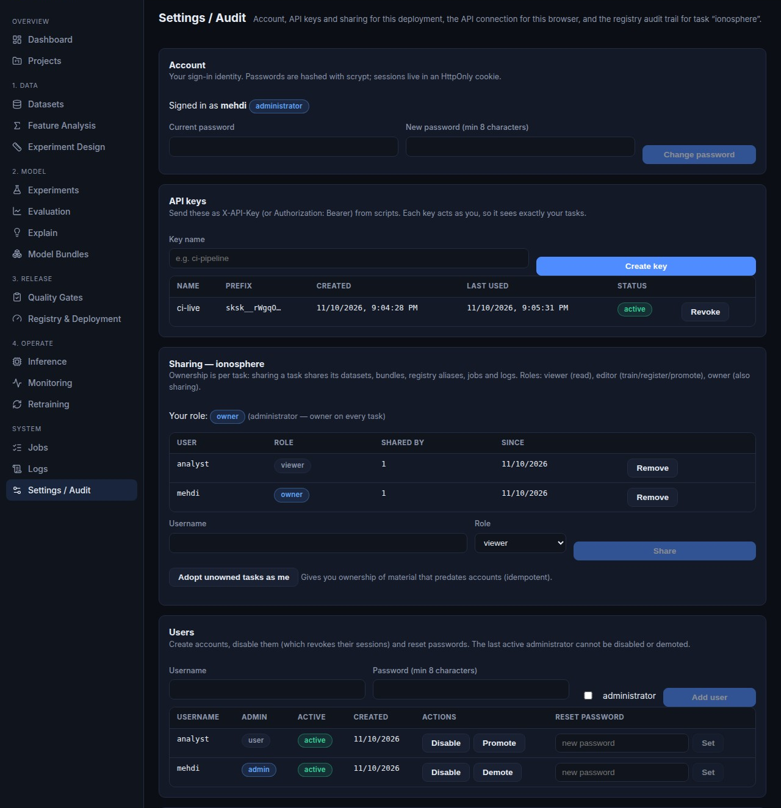

Authentication, users and sharing
=================================

The control plane started with exactly one credential — the shared
``SKSURROGATE_API_KEY`` environment variable — which is enough to close an open
port but cannot say *who* a caller is. This chapter documents the identity and
ownership layer: user accounts, browser sessions, per-user API keys, and sharing
of datasets, models, artifacts and projects between accounts.

Everything here is **opt-in**. With no shared key and no
``SKSURROGATE_REQUIRE_AUTH``, the API behaves exactly as it did before: one
anonymous user, every ``/api`` route open, no ownership filtering. Configure a
credential and the rules below apply.

.. contents::
   :local:
   :depth: 2

Enabling authentication
-----------------------

Set ``SKSURROGATE_REQUIRE_AUTH`` and create the first administrator. The startup
check refuses to start a deployment that would lock itself out — that is, with
enforcement on and no credential of any kind.

.. code-block:: bash

   export SKSURROGATE_REQUIRE_AUTH=true
   export SKSURROGATE_API_KEY='break-glass-secret'      # optional
   python -m api.auth_cli create-admin --username mehdi # prompts for a password
   uvicorn api.main:app --host 0.0.0.0 --port 8013

The first administrator can also be bootstrapped from the environment, which is
what a container needs. It is idempotent: once the account exists the variables
do nothing, so a changed password is never reset by a restart.

.. code-block:: bash

   SKSURROGATE_ADMIN_USERNAME=mehdi
   SKSURROGATE_ADMIN_PASSWORD='change-me-now'   # remove after the first start

.. warning::

   ``SKSURROGATE_ADMIN_PASSWORD`` is read from the process environment and is
   visible to anything that can inspect the container. Delete it after the first
   successful start; from then on use ``python -m api.auth_cli set-password`` or
   the **Settings → Users** card.

Account management from a shell
-------------------------------

``python -m api.auth_cli`` (with ``--api-home`` to point at a specific storage
root) is the offline equivalent of the admin UI. Passwords are read from a
prompt or ``--password-stdin`` so they never land in shell history.

.. code-block:: bash

   python -m api.auth_cli list-users
   python -m api.auth_cli add-user --username analyst        # prompts
   python -m api.auth_cli add-user --username ops --admin
   python -m api.auth_cli set-password --username analyst
   python -m api.auth_cli disable --username analyst
   python -m api.auth_cli create-key --username analyst --name ci

How a caller authenticates
--------------------------

Three credentials are accepted, in this order:

``X-API-Key`` header or ``Authorization: Bearer <key>``
   A per-user API key (prefix ``sksk_``) created in the UI or with the CLI, or
   the legacy shared ``SKSURROGATE_API_KEY``. The shared key resolves to an
   admin-equivalent break-glass principal with no user account.

Session cookie
   ``sksurrogate_session``, set by ``POST /api/auth/login`` with ``HttpOnly`` and
   ``SameSite=Strict``. Only a SHA-256 digest of the token is stored, so
   sessions are revocable server-side (unlike a JWT).

``api_key`` query parameter
   WebSocket handshakes only, because browsers cannot set custom headers on
   ``new WebSocket(...)``. Note that the value appears in proxy access logs, so
   prefer a session or a short-lived key there.

Cookie-authenticated **mutating** requests must also carry a same-origin
``Origin`` header; a cross-site request is refused with ``403``. API-key callers
are unaffected.

Authentication endpoints
------------------------

.. list-table::
   :header-rows: 1
   :widths: 45 55

   * - Route
     - Purpose
   * - ``GET /api/auth/status``
     - Public. Whether auth is enforced, whether anybody can log in yet
       (``login_available``), and whether bootstrap is required.
   * - ``POST /api/auth/login``
     - ``{"username": ..., "password": ...}`` → session cookie. Five failures per
       username and client address in 15 minutes answer ``429``.
   * - ``POST /api/auth/logout``
     - Revokes the session and clears the cookie (idempotent).
   * - ``GET /api/auth/me``
     - Identity plus ``source``: ``session``, ``api_key``, ``static`` (the shared
       key) or ``anonymous`` (auth not enforced).
   * - ``POST /api/auth/password``
     - ``{"current_password", "new_password"}``; the caller's other sessions are
       revoked.
   * - ``GET/POST /api/auth/keys``, ``DELETE /api/auth/keys/{id}``
     - Own API keys. **The secret is returned once**; listings show only the
       prefix, creation time and last use.
   * - ``GET/POST /api/auth/users``, ``PATCH /api/auth/users/{id}``
     - Admin only: create, disable/enable, promote/demote, reset a password. The
       last active administrator cannot be disabled or demoted.
   * - ``POST /api/auth/users/{id}/logout``
     - Admin only: revoke every session of another account.
   * - ``GET /api/auth/audit``
     - Admin only: recent identity events (newest first, bounded by ``limit``).

Audit trail
-----------

Every identity event is appended to ``<API home>/logs/auth.jsonl`` — one JSON
line per event, never rewritten, readable with ``tail -f`` or shipped as-is:

.. code-block:: json

   {"event": "login", "outcome": "ok", "username": "mehdi", "source": "cookie",
    "client": "10.0.0.7", "timestamp": "2026-11-11T04:12:31+00:00"}

Recorded events: ``login`` (``ok`` / ``denied`` / ``throttled``), ``logout``,
``password.change``, ``api_key.create``, ``api_key.revoke``, ``user.create``,
``user.update`` and ``user.sessions_revoked``. Entries carry the account,
client address, key **prefix** and affected target — never a password, a session
token or a full API key, so the file is safe to inspect and to share while
debugging. Administrators read it through ``GET /api/auth/audit``; the endpoint
returns the last ``limit`` events (maximum 500) and never mutates the file.

The per-job log store is separate: it only captures records emitted while a
background job is running, which is why identity events get their own file.

Ownership model
---------------

Storage is keyed by ``task_name``: datasets, bundles, registry aliases,
monitoring records, checkpoints and jobs all live under a task. That makes the
**task** the unit of access control — sharing a task shares its data, models and
every artifact derived from them — and projects own themselves.

Three roles, ordered:

``viewer``
   Read anything under the resource: list, inspect, download, predict.
``editor``
   Additionally register datasets, train and save bundles, promote in the
   registry, submit jobs.
``owner``
   Additionally change the share list and delete the resource.

Enforcement rules:

* a read requires ``viewer``; any mutating method requires ``editor``;
* administrators (and the shared key) hold ``owner`` on everything;
* a resource with **no owner yet** is usable by any authenticated caller, and
  the first authenticated write claims it — this keeps pre-auth data usable the
  moment enforcement is switched on;
* no access answers ``404`` and insufficient role answers ``403`` with the role
  required, so the task namespace is never leaked to strangers;
* list endpoints (``/api/tasks``, ``/api/projects``, ``/api/jobs``) are filtered
  to what the caller may see.

Sharing endpoints
-----------------

.. list-table::
   :header-rows: 1
   :widths: 45 55

   * - Route
     - Purpose
   * - ``GET /api/access/tasks``, ``GET /api/access/projects``
     - Resources the caller can see, with their role.
   * - ``GET /api/access/tasks/{task_name}``
     - Share list plus the caller's role. ``/projects/{project_id}`` mirrors it.
   * - ``POST /api/access/tasks/{task_name}/shares``
     - ``{"username": ..., "role": "viewer|editor|owner"}``; owner only.
   * - ``DELETE /api/access/tasks/{task_name}/shares/{user_id}``
     - Revoke a grant. Removing the last owner is refused.
   * - ``POST /api/access/adopt``
     - Admin only: give one account ownership of every unowned resource of a
       kind. Idempotent; run it once after switching a single-user deployment
       to authenticated mode.

.. code-block:: bash

   # Share task "ionosphere" read-only with the analyst account
   curl -X POST http://localhost:8013/api/access/tasks/ionosphere/shares \
        -H "X-API-Key: $SKSURROGATE_API_KEY" -H 'Content-Type: application/json' \
        -d '{"username": "analyst", "role": "viewer"}'

   # Adopt all pre-auth tasks as the administrator
   curl -X POST http://localhost:8013/api/access/adopt \
        -H "X-API-Key: $SKSURROGATE_API_KEY" -H 'Content-Type: application/json' \
        -d '{"kind": "task"}'

Using the web UI
----------------

With enforcement on and no session, the UI renders a login screen instead of the
application; no page is mounted and no page-level request is issued. The shell
shows the signed-in account and a **Sign out** button.

**Settings → Account** changes your password (other sessions are signed out).
**Settings → API keys** creates and revokes keys; the secret is displayed once.
**Settings → Sharing** manages the share list of the task selected in the top bar
and, for administrators, adopts unowned material. **Settings → Users**
(administrators only) creates accounts, disables them — which immediately
revokes their sessions — and resets passwords.

   The authenticated Settings page: signed in as an administrator, one API key
   in use, task ``ionosphere`` shared read-only with the ``analyst`` account,
   and both accounts listed for management.

An API key created in the UI keeps working without a browser session:

.. code-block:: bash

   curl -H "Authorization: Bearer sksk_..." http://localhost:8013/api/tasks

Storage and deployment
----------------------

Two SQLite databases live under the API home (``SKSURROGATE_API_HOME``,
``/data`` in the container):

``auth/auth.db``
   ``users`` (scrypt digests), ``sessions`` (token digests, expiry),
   ``api_keys`` (key digests, prefix, last use, revocation).
``auth/acl.db``
   ``grants``: ``(kind, resource_id, user_id) → role`` for tasks and projects.

Back them up with the rest of the API home; deleting ``auth.db`` resets every
account, and deleting ``acl.db`` makes all material unowned (visible to every
signed-in user until adopted again).

The Compose **prod** service forwards the auth variables. Add bootstrap
credentials only for the first start:

.. code-block:: yaml

   environment:
     SKSURROGATE_API_KEY: ${SKSURROGATE_API_KEY:-}
     SKSURROGATE_REQUIRE_AUTH: ${SKSURROGATE_REQUIRE_AUTH:-}
     SKSURROGATE_ADMIN_USERNAME: ${SKSURROGATE_ADMIN_USERNAME:-}
     SKSURROGATE_ADMIN_PASSWORD: ${SKSURROGATE_ADMIN_PASSWORD:-}
     SKSURROGATE_SESSION_TTL: ${SKSURROGATE_SESSION_TTL:-604800}
     SKSURROGATE_SESSION_COOKIE_SECURE: ${SKSURROGATE_SESSION_COOKIE_SECURE:-}

Set ``SKSURROGATE_SESSION_COOKIE_SECURE=true`` whenever the UI is served over
HTTPS — the cookie is then marked ``Secure`` as well as ``HttpOnly`` and
``SameSite=Strict``.

Limitations
-----------

* Task names are a global namespace: two accounts cannot both own a task called
  ``iris``; the second registration sees the existing task instead of a private
  copy. Physical per-user directories would be a larger migration.
* No e-mail password reset, no OAuth/SSO, no second factor.
* Login throttling is per process and in memory; put a real rate limiter in
  front of a public deployment (with TLS, since session cookies must not travel
  in clear text).
* The ACL is metadata, not directory layout: a filesystem-level compromise of
  the API home exposes everything, exactly as it does for an open deployment.
