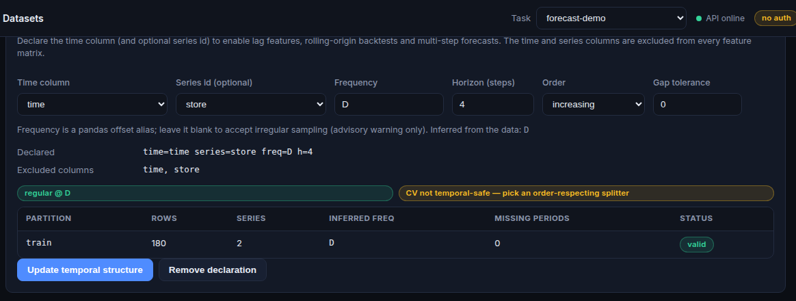
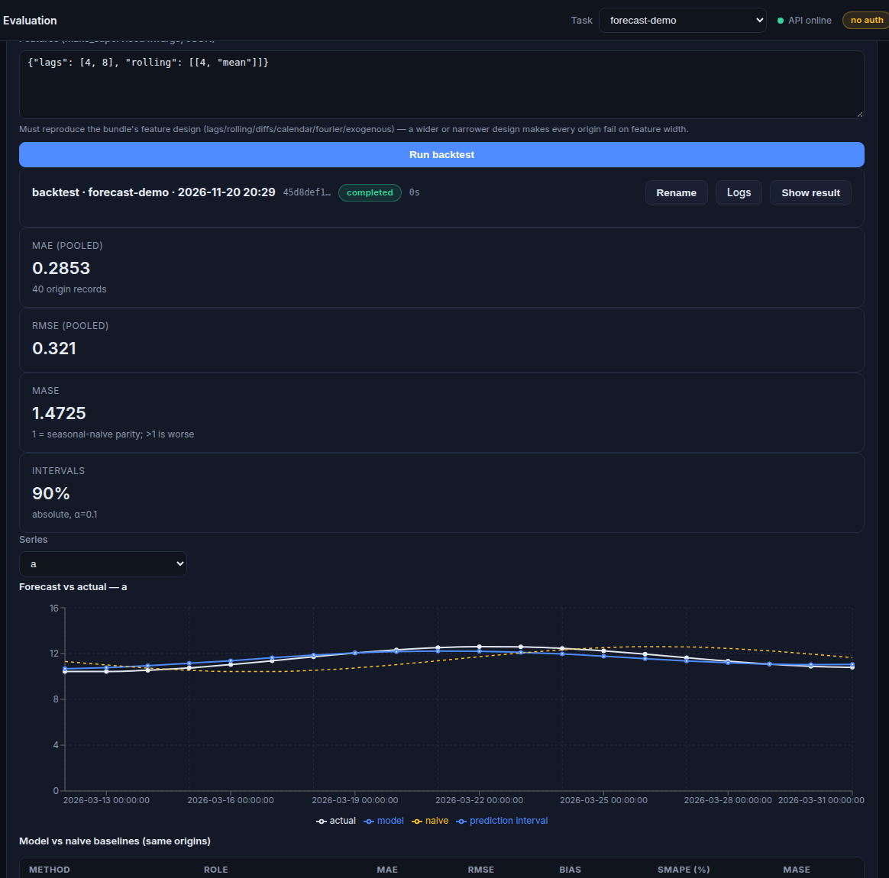

.. _forecasting:

Time series and forecasting
===========================

SKSurrogate is a tabular surrogate-modelling and experiment-tracking system. It does
not replace a forecasting library, but it can *hold* a forecasting problem: declare the
temporal structure of a dataset, and the tracker validates it, keeps the time index out
of the feature matrix, and refuses cross-validation schemes that leak.

Temporal support is **opt-in**. A task with no temporal declaration behaves exactly as
before: no timestamp inference, no re-ordering, no splitter restrictions.

.. note::

   Current scope (this page documents what ships today): the temporal **data
   contract** — declaration, validation, metadata, ignore-list wiring and
   splitter enforcement — and the **leakage-safe feature builder**
   (``ForecastFeatureBuilder`` / ``make_supervised``), **rolling-origin backtesting**
   (``RollingOriginSplit`` / ``mltrack.backtest``) and **forecast metrics with naive
   baselines** (MASE, sMAPE, pinball/Winkler, naive/seasonal-naive/drift/mean).
   **Horizon-aware prediction intervals** (split-conformal calibration on backtest
   residuals), and **bundled multi-step inference**: a format-v2 bundle carries the
   serving state of its design, so ``bundle.predict_forecast(history)`` produces a
   full horizon-$h$ forecast from history alone. The web UI carries the temporal
   panel, the backtest view, the forecast chart and the inference console (see
   :ref:`forecasting-ui` below).

Problem type and time structure are different axes
---------------------------------------------------

A task answers two independent questions:

* **which learning problem** it is — ``regression`` or ``classification``
  (``problem_type``, inferred from the target at registration and overridable on the
  Datasets page);
* **whether it has time structure** — a ``TemporalSpec`` or nothing.

"Time series" is therefore *not* a third problem type. A forecasting task is a
regression problem with a declared time axis, which is why the library pins it to
regression: the feature builder casts the target to float and the backtest scores
:math:`\text{MAE}`, :math:`\text{RMSE}` and :math:`\text{MASE}`, so a declared
classification would be a label pretending to be a forecast. Declaring a temporal spec
on a task whose stored ``problem_type`` is ``classification`` is refused with an
explicit message; clearing the override (``DELETE /api/datasets/{task}/problem-type``)
lets the inference run again.

The declaration is read by the rest of the system instead of being re-guessed:
Quick start defaults its preset from it, the baseline route chooses (and validates)
a matching estimator, and delayed-label monitoring uses the matching metrics.

Declaring a temporal spec
-------------------------

.. code-block:: python

    from SKSurrogate import TemporalSpec, mltrack

    spec = TemporalSpec(
        time_column="date",       # required
        series_id="store",        # optional: one identifier per series (panel data)
        freq="D",                 # optional: expected pandas offset alias
        horizon=7,                # forecast horizon in steps, >= 1
        order="increasing",       # or "decreasing"
        gap_tolerance=0,          # missing periods tolerated when freq is declared
    )

    tracker = mltrack("weekly-sales", db_name="tracking.db")
    tracker.RegisterData(frame, "sales", partition="train", temporal=spec)
    tracker.SetTemporalSpec(spec)         # re-validate every registered partition
    tracker.GetTemporalSpec()             # -> spec dict, or None
    tracker.ClearTemporalSpec()           # remove the declaration

``RegisterData`` validates the frame **before** writing it, so a rejected upload leaves
no partial state behind. ``SetTemporalSpec`` validates every partition already in the
database (``train``, ``validation``, ``test``, ...) unless you pass ``partitions=[...]``.

What validation checks
----------------------

Structural violations raise ``TemporalValidationError`` (a ``ValueError`` subclass) with
a ``report`` attribute; the report is also stored in the task metadata and returned by
the control plane.

===================  ==============================================================
Check                Failure mode
===================  ==============================================================
Column presence      ``time_column`` / ``series_id`` missing from the frame.
Time parsing         Values that cannot be read as timestamps (or non-finite values
                     on a numeric axis).
Row order            Rows not ``increasing`` (or ``decreasing``) within each series.
Duplicate times      The same timestamp twice inside one series — order-independent.
Missing identifiers  ``NaN`` in the ``series_id`` column.
Declared frequency   More than ``gap_tolerance`` missing periods, or timestamps off
                     the declared grid.
===================  ==============================================================

Advisory findings stay in the report as ``warnings``: irregular spacing when no
``freq`` is declared, gaps measured against an *inferred* frequency, and series shorter
than the horizon (a forecast cannot be backtested without more history).

Two time-axis kinds are accepted. Datetime-like columns are parsed with
``pandas.to_datetime`` and compared as integer nanoseconds — never as floats, because
contemporary timestamps exceed 2\\ :sup:`53` ns and a float axis would silently lose
precision. Integer or float columns are treated as an **index axis** (``0, 1, 2, ...``),
not as 1970 timestamps.

The report looks like this (returned by ``GET /api/datasets/{task}/temporal``)::

    {"ok": true, "time_kind": "datetime", "rows": 120, "series_count": 2,
     "declared_freq": "D", "inferred_freq": "D", "missing_periods": 0,
     "time_range": {"start": "2026-01-01 00:00:00", "end": "2026-04-30 00:00:00"},
     "series_lengths": {"A": 60, "B": 60},
     "series": [{"series": "A", "rows": 60, "regular": true, ...}],
     "warnings": [], "errors": []}

Temporal columns never become features
--------------------------------------

The time column and the series identifier describe *when* and *which series*, not
*what*. They are excluded from the feature matrix by default:

* ``mltrack.RegisterData`` drops them from ``self.X`` and ``get_data``;
* the control plane adds them to the dataset's **ignored columns**, so every training,
  profiling, EDA, sensitivity and monitoring path that honours the ignore list drops
  them too.

Time reaches a model through generated features only. Letting a datetime column through
as ``DataProcess``'s scaled epoch-seconds feature is the trap this rule closes.

.. _forecasting-splitters:

Splitters: order-respecting only
--------------------------------

A temporal task may only use splitters from ``TEMPORAL_CV_SPLITTERS`` (currently
``TimeSeriesSplit``). ``SetCV`` raises a ``ValueError`` for ``KFold``, ``ShuffleSplit``,
stratified splitters, a bare integer fold count and the library default, because each of
them trains on future observations and scores on past ones — the score is then an
artifact of leakage rather than evidence::

    tracker.SetCV({"type": "TimeSeriesSplit", "n_splits": 4, "gap": 7})

Choose ``gap`` at least as large as the forecast horizon so the training window never
contains observations that overlap the test window's information set.

.. _forecasting-manual-features:

Leakage-safe feature construction
---------------------------------

.. code-block:: python

    from SKSurrogate import TemporalSpec, make_supervised

    spec = TemporalSpec(time_column="date", series_id="store", freq="D", horizon=7)
    design = make_supervised(
        frame,                      # must be ordered; still contains the target
        spec,
        target="sales",
        lags=[7, 14, 28],           # each lag must be >= horizon
        seasonal_lags=[7, 365],     # readable alias: lag at the season period
        rolling=[{"window": 28, "stats": ["mean", "std"]}, 7],
        diffs=[1],
        pct_changes=[1],
        calendar=["dow", "doy", "is_weekend"],
        fourier={"periods": [7, 365.25], "terms": 2},
        exogenous=["promo_flag"],   # must be known at the forecast origin
    )

    design.X            # feature matrix
    design.y            # label at t + horizon (direct) or t + 1 (recursive)
    design.meta         # series, origin_time, target_time, horizon, target_step
    design.feature_names
    design.describe()   # JSON-safe provenance for task metadata

The rules the builder enforces, not merely documents:

* **Shift $\ge$ horizon.** Every target-derived feature reads at most up to
  $t - h$: ``lag_k`` is $y_{t-k}$ ($k \ge h$), and a rolling window of width $w$
  covers $y_{t-h-w+1},\dots,y_{t-h}$. A lag shorter than the horizon is rejected
  at ``fit`` time — it would read an observation the forecast is meant to predict.
  ``seasonal_lags=[p]`` is the same rule under a readable name (column
  ``sales__seasonal_lag_7``, ``op="seasonal_lag"`` in the provenance).
* **No centring.** ``center=True`` does not exist in this API.
* **Per-series isolation.** On a panel, every operation is computed inside its own
  series, so one store's history never enters another store's lags.
* **No partial windows by default.** ``min_periods`` defaults to the window width.
* **NaN, never ``inf``.** A zero denominator in ``pct_change`` yields ``NaN``.
* **Immutability of the past.** Calendar and Fourier terms come from the timestamp
  itself, which is known at forecast time; the exogenous columns are passed
  through unchanged and documented as known-at-origin.

Feature names encode their provenance (``sales__lag_7``, ``sales__roll_mean_28``,
``sales__diff_1``, ``cal__dow``, ``fourier__sin_7_1``), and
``design.feature_specs`` carries the same information structurally, including the
minimum ``shift`` of each column.

Direct vs recursive
~~~~~~~~~~~~~~~~~~~

``strategy="direct"`` (default) builds one label per horizon, $y_{t+h}$, so a model
learns the multi-step mapping directly. ``strategy="recursive"`` labels only the
next step ($y_{t+1}$) while the declared horizon still constrains the features;
at serve time the model feeds its own prediction back. ``design.horizon`` is the
declared horizon and ``design.target_step`` is what the label actually is.

Verifying the invariant
~~~~~~~~~~~~~~~~~~~~~~~

``assert_no_leakage`` turns the claim into a test: it masks every non-temporal
column strictly after a cut time and rebuilt features for origins at or before
that cut must be unchanged. A feature that reads the future either changes value
or disappears (it now reads a missing observation), and the guard raises
:class:`~SKSurrogate.LeakageError` naming the columns:

.. code-block:: python

    from SKSurrogate import assert_no_leakage

    assert_no_leakage(builder, frame, spec)     # {'ok': True, 'cut_points_checked': 3, ...}

This is an empirical guard over structural properties, not a proof; run it once per
feature configuration in your test suite.

Scikit-learn interoperability
~~~~~~~~~~~~~~~~~~~~~~~~~~~~~

``ForecastFeatureBuilder`` is an estimator with ``get_params``/``set_params`` and
``fit``/``transform``, so it clones inside pipelines. One wrinkle is deliberate:
``transform`` needs the **target column in the frame** because lag features are
built from it. The control plane's feature matrix drops the target, so materialize
the design matrix before registration, or keep the target in the frame you hand to
the builder.

If you cannot use the builder (exotic features, existing pipeline), the manual
fallback is still: keep rows chronological, shift every feature by at least the
horizon per series, never use ``center=True``, and never aggregate a window that
includes the target step.

Rolling-origin backtesting
--------------------------

``TimeSeriesSplit`` is a fixed-window approximation; ``RollingOriginSplit`` states
the forecast horizon directly, so each test window is exactly ``horizon`` steps
long and origins advance by ``step``::

    from SKSurrogate import RollingOriginSplit, mltrack

    tracker = mltrack("weekly-sales", db_name="tracking.db")
    tracker.SetCV(RollingOriginSplit(n_splits=6, horizon=7, step=7))

The tracker-level entry point builds the design matrix itself and walks origins
forward::

    result = tracker.backtest(
        LinearRegression(),
        n_splits=6,
        horizon=7,
        step=7,
        refit="every_fold",          # or "first", or "every:2"
        scoring=get_scorer("neg_mean_absolute_error"),
        scoring_label="neg_mean_absolute_error",
        feature_kwargs={"lags": [7, 14], "rolling": [{"window": 28, "stats": ["mean"]}]},
    )

    result["pooled"]        # mae, rmse, bias, smape, mase for the model
    result["baselines"]     # the same metrics for each naive baseline
    result["ranking"]       # MASE ordering with the "worse than baseline" flags
    result["intervals"]     # calibrated offsets + coverage diagnostics (alpha=0.1)
    result["folds"]         # per-fold score/metrics, train/test sizes, whether it refitted
    result["origins"]       # per-origin series, origin_time, target_time, y_true, y_pred
    result["per_series"]    # the same metrics per series on a panel
    result["design"]        # features actually used, with their provenance

What the result guarantees:

* **No overlap.** Training rows stop one step before the origin and the test window
  starts there; the geometry comes from :func:`~SKSurrogate.rolling_origin_indices`, which is
  validated against the available history and raises instead of silently shrinking.
* **Honest labels.** Each record pairs a prediction with the actual value at
  ``origin_time + horizon`` (``target_step`` in ``meta``).
* **Counted fits.** The refit policy is enforced, not just recorded: ``"every_fold"``
  fits once per origin, ``"first"`` fits once in total, ``"every:k"`` every k-th
  fold. ``result["folds"][i]["refitted"]`` says which folds refitted.
* **A cost ceiling.** ``cost_limit`` (default 64 fits) turns an accidental
  hundreds-of-origins run into a clear ``ValueError``.
* **Panel semantics.** With a ``series_id``, every series gets its own origins and
  the model is fitted on the union of all series' training windows; series too short
  for the geometry are skipped and listed in ``skipped_series``.
* **Persistence.** The full result is stored in task metadata under
  ``backtest:<config hash>`` unless ``store=False``; per-origin records are capped
  by ``max_records`` with an ``origins_truncated`` count.
* **Timings.** Every fold record carries ``fit_time`` and ``predict_time`` in
  seconds (``fit_time`` is 0 on folds that reused the previous fit), and each origin
  record repeats both, so the documented cost of a run can be checked against what it
  actually cost.

Both strategies are evaluated. ``strategy="direct"`` trains one model on labels
$y_{t+h}$; ``strategy="recursive"`` trains on $y_{t+1}$ and **replays the horizon** from
each origin by feeding every prediction back into the lag history. Recursive folds
share :func:`~SKSurrogate.temporal.recursive_steps` with serving, so a fold's
predictions for an origin and the bundle's ``predict_forecast`` output for the same
origin agree to machine precision (this is asserted in
``tests/test_backtest.py``). A recursive fold records one origin and ``horizon``
step records (``target_step`` 1..h), which is what makes the per-horizon table
meaningful instead of a single row. A custom ``scoring=`` callable needs a feature
matrix, which a recursive fold does not keep, so its fold score is recorded as
``None`` rather than faked; pooled metrics and every baseline are still computed.

**Feature configuration must match how the model was trained.** ``backtest`` refits
the estimator on the design it builds, so a bundle trained on a different feature
set will fail on width rather than produce a misleading score. Keep the
``feature_kwargs`` in the request/bundle metadata alongside the model.

Forecast metrics and baselines
------------------------------

Point metrics (``SKSurrogate.forecast_metrics``):

* **MAE** $\frac1n\sum\lvert y_t-\hat y_t\rvert$ and **RMSE**
  $\sqrt{\frac1n\sum(y_t-\hat y_t)^2}$ — in the target's units.
* **bias** $\frac1n\sum(\hat y_t-y_t)$ — positive means over-forecasting.
* **sMAPE**, reported in percent:
  $\frac{100}{n}\sum \frac{2\lvert\hat y_t-y_t\rvert}
  {\lvert\hat y_t\rvert+\lvert y_t\rvert}$.
  A term where both values are zero contributes 0, never ``inf``.
* **MASE** $\frac{\frac1n\sum\lvert y_t-\hat y_t\rvert}
  {\frac{1}{n-m}\sum_t\lvert y_t-y_{t-m}\rvert}$,
  where the denominator is the mean absolute $m$-step difference of the **in-sample
  history**. Because that scale is fixed by the history, a seasonal-naive forecast
  scores exactly 1.0 — which is what makes "worse than naive" a precise statement.
* **RMSE scaled** — the same scaling applied to RMSE.

Interval and quantile metrics:

* **pinball_loss(y, ŷ, q)** — the quantile loss; at $q=0.5$ it is exactly
  $\tfrac12\,\mathrm{MAE}$.
* **winkler_score(y, lower, upper, α)** — interval width plus
  $\tfrac{2}{α}$ times each miss, for central intervals at level $1-α$.
* **interval_coverage** and **interval_width** — empirical coverage and mean width.

``summarize(...)`` returns one block with all of these, plus optional
``per_series`` / ``per_horizon`` groupings. Its ``aggregation`` argument chooses
what ``primary`` reports: ``"pooled"`` (every prediction weighted equally — honest for
one series, misleading across series of different magnitude) or ``"macro"`` (each
series counts once). The per-series block is always returned alongside it.

Baselines
~~~~~~~~~

Every backtest scores five naive baselines on **the same origins** as the model:

* ``naive`` — the last observation, $\hat y_{T+h} = y_T$;
* ``seasonal_naive`` — the same phase one season earlier,
  $\hat y_{T+h} = y_{T+h-m\lceil h/m\rceil}$ (for $h=m$ this is $y_T$);
* ``drift`` — last value plus the average change per step, times $h$;
* ``mean`` — the arithmetic mean of the history;
* ``historical_mean_by_series`` — the same mean, named explicitly. A backtest always
  conditions on one series' own history, so there is no pooled cross-series mean to
  distinguish; the two names denote one computation, and a test pins their equality.

``baseline_prediction(history, method, horizon, seasonality)`` computes any of them
from an ordered history array; ``baselines=(...)`` on ``backtest`` selects which are
scored (default: all five). A model that cannot beat ``seasonal_naive`` on MASE has
not earned the word "forecast", and the result says so:

.. code-block:: python

    result["ranking"]
    # {"metric": "mase",
    #  "best": {"label": "baseline:seasonal_naive", "value": 1.0,
    #           "beats_baseline": False, "worse_than_baseline": False},
    #  "ranked": [...], "unranked": [], "winner_beats_baseline": False}

The guard distinguishes parity from failure: MASE **equal** to 1 is exact parity with
the benchmark (``beats_baseline: false``, ``worse_than_baseline: false``), while
``> 1`` is worse. Candidates whose metric is missing or non-finite are listed under
``unranked`` instead of being sorted to the bottom, so a broken run cannot look like
a bad one.

Baseline bundles
~~~~~~~~~~~~~~~~

``POST /api/bundles/{task}/train-baseline`` adapts to a declared temporal spec: instead
of a scaler-plus-regressor over feature columns, the bundle's model is a ``Pipeline``
whose first step is ``ForecastFeatureBuilder``, its record carries the serving
geometry (``temporal``), and its ``metrics`` / ``baseline_scores`` come from a
rolling-origin backtest with ``refit="first"`` — so seasonal naive is always measured
next to the chosen model on identical origins. Such a bundle can be served directly
through :ref:`forecast-inference`; a tabular baseline bundle is unchanged and has no
``temporal`` block. The request accepts ``horizon``, ``features``, ``strategy``,
``seasonality`` and ``n_splits``.

MASE is not a scikit-learn scorer
~~~~~~~~~~~~~~~~~~~~~~~~~~~~~~~~~

MASE needs the in-sample history of each training window, and a scikit-learn scorer
only ever sees ``(y_true, y_pred)``. Rather than invent a denominator, MASE is
computed by the rolling-origin backtest, where the training window of every origin is
known. ``rmse_scaled`` has the same requirement and is absent for the same reason;
``winkler_score`` needs ``(lower, upper)`` bounds, which a scorer's signature cannot
carry. All three live in ``SKSurrogate.forecast_metrics`` and are applied to stored
backtest predictions. For plain CV and learning curves, **sMAPE** is available as
``neg_smape`` (sign-flipped, as scikit-learn scorers are), and pinball loss via
``neg_mean_pinball_loss`` with an explicit ``pinball_alpha``.

Feature analysis on a temporal task
~~~~~~~~~~~~~~~~~~~~~~~~~~~~~~~~~~~

A time-series partition usually has no raw feature column at all: the time (and panel
id) columns are excluded by the temporal contract and the target is the label. Running
sensitivity or Pearson pruning on such a partition used to answer "no numeric feature
columns — encode or drop those columns", which described columns that did not exist.

Those analyses now run over the **generated design**, built by the same
``make_supervised`` call the backtest uses:

* features are ``<target>__lag_h``, rollings, diffs, pct-changes and calendar fields —
  names and provenance are reported in the job result
  (``evaluation_protocol.feature_source == "temporal_design"`` plus
  ``temporal.feature_specs``);
* the default design is one lag at the declared horizon; pass ``features`` to
  ``POST /api/sensitivity/{task}/run`` (and as a JSON query parameter to
  ``/correlation-threshold`` and ``/correlation-matrix``) to mirror the model's
  configuration;
* calendar fields are derived from the parsed time column, so an ISO date stored as a
  plain string in the CSV works: the builder parses it with ``pandas.to_datetime``
  rather than trusting the stored dtype;
* a design with a single feature is an all-kept pruning answer, not an error.

Because these features are transforms of the target, their correlations are structural
and the sampled ranges are synthetic: the ranking explains *which history windows* a
model leans on. The rolling-origin backtest remains the accuracy statement, and the
limitations block in the result says exactly that.

Two data-quality views follow the same rule:

* ``GET /datasets/{task}/{partition}/duplicates`` judges duplicates on the **row
  identity** (``time``, or ``series + time``) when no raw feature column exists, and
  reports ``key_kind: "temporal_identity"``. Registration already rejects a repeated
  key, so zero duplicates is the expected answer — the warning says so, and lists the
  key it used. An extra raw feature column (say ``temperature``) still defines the key,
  as it does for a tabular task; ``columns=`` overrides the key explicitly.
* ``GET /datasets/{task}/{partition}/encoding-preview`` shows the **generated design**
  instead of the stored columns: every column is numeric (``kind: "generated"``, with
  its builder op and shift), so no categorical vocabulary is claimed. It answered
  "No active feature columns to encode" before, which was true but useless. Each
  preview row is labelled with its **origin timestamp** (``preview_label_name`` /
  ``preview_labels``), so the consumed time axis stays visible instead of looking
  dropped, and ``features`` accepts the same ``make_supervised`` JSON as the backtest
  — the default design is one lag at the declared horizon, so a richer design (lags,
  rollings, ``calendar``) has to be requested explicitly.

Prediction intervals
--------------------

``result["intervals"]`` calibrates an interval from the held-out residuals of the
backtest::

    result = tracker.backtest(
        LinearRegression(), n_splits=20, horizon=7, alpha=0.1,
        interval_method="absolute",       # or "asymmetric"
        min_residuals=10,
        feature_kwargs={"lags": [7, 14]},
    )

    result["intervals"]["available"]     # False when the calibration was refused
    result["intervals"]["calibration"]   # {"lower_offset": ..., "upper_offset": ...}
    result["intervals"]["diagnostics"]   # coverage, width, Winkler, per-horizon groups

The construction is split-conformal on the residuals $r_i = y_i - \hat y_i$ of
origins the model never trained on:

* ``absolute`` — the interval is $\hat y \pm q$ with $q$ the
  $\lceil (n+1)(1-\alpha)\rceil/n$ quantile of $\lvert r \rvert$;
* ``asymmetric`` — $[\hat y + r_{(k_{\text{low}})},\; \hat y + r_{(k_{\text{high}})})]$
  using the empirical ``alpha/2`` and ``1 - alpha/2`` order statistics, for skewed
  residuals.

Two properties are reported rather than assumed:

* **Coverage is marginal and approximate.** The finite-sample guarantee needs
  exchangeable residuals; a walk-forward backtest is *ordered*, so the diagnostics
  report the empirical coverage with a Wilson interval instead of asserting the
  nominal number.
* **A short calibration set is refused, not fudged.** Below ``min_residuals`` the
  result carries ``available: false`` plus the reason, so a three-point quantile
  never becomes an "interval".

Per-horizon diagnostics come from ``interval_diagnostics``, which passes the horizon
step as the grouping key to ``prediction_interval_diagnostics`` — a horizon-1 and a
horizon-12 interval are reported separately instead of being averaged into one
number::

    from SKSurrogate import interval_diagnostics

    interval_diagnostics(y_true, lower, upper, alpha=0.1, horizon=steps)
    # {... "subgroup_coverage": {"groups": [{"group": "1", ...}, {"group": "12", ...}]}}

Serving without recomputation
~~~~~~~~~~~~~~~~~~~~~~~~~~~~~

Calibration is a bundle field, so a served model can widen a point forecast without
re-running the backtest::

    bundle.interval_calibration = result["intervals"]["calibration"]
    save_bundle(bundle, path)

    lower, upper = bundle.interval_bounds(predictions)   # arrays

``interval_bounds`` **raises** when the bundle was never calibrated. An uncalibrated
bundle must not emit a zero-width interval that reads as "certain".

.. _forecasting-serving:

Bundled multi-step inference
----------------------------

A trained forecasting model is useless unless it can be *served* — asked for the next
$h$ steps from history alone, with no feature matrix to hand over. A format-v2 bundle
stores that serving state beside the estimator itself. ``TemporalServeState`` keeps
only the geometry — spec, target column, feature configuration and strategy (a fitted
:class:`~SKSurrogate.ForecastFeatureBuilder` is behaviorally defined by its constructor arguments, so
no fit artifact is persisted) — and serializes into the record's optional ``temporal``
block::

    from SKSurrogate import TemporalServeState, serve_forecast

    state = TemporalServeState.from_parts(
        spec=spec, target="sales", builder_or_feature_spec=builder, strategy="direct"
    )
    # bundle.to_dict()["temporal"] == state.to_dict(); loading rebuilds it via from_dict

Serving itself is a pure function of the *bundle* and the history — no tracker, no
database, no file access::

    result = serve_forecast(bundle, history=recent_rows)        # horizon from the design
    result = bundle.predict_forecast(history)                   # same call via ModelBundle
    result = bundle.predict_forecast(
        history, future_exogenous=exo_rows                      # recursive + exogenous only
    )

``ForecastResult`` carries ``times`` (origin+1 .. origin+$h$), ``means``, and — only when
the bundle holds an interval calibration — per-step ``lower``/``upper`` arrays plus a
descriptive ``interval_note``. :meth:`~SKSurrogate.ForecastResult.to_frame` gives the long form with
columns ``series_id, time, mean, lower, upper`` (bounds render as NaN there when not
calibrated).

History requirements are checked before any prediction is made and refused with an
actionable ``ValueError``: the frame must hold **one series** — exactly one value of
the declared ``series_id``, strictly increasing in time (a forecast is produced per
call, per series); at least :meth:`~SKSurrogate.TemporalServeState.required_length` rows so every
feature read at the first evaluated position is backed by real data — for horizon $h$, a
rolling window of width $W$ alone needs $2h + W - 1$ rows under *direct* (each of the last $h$
origins re-reads history) but only $h + W - 1$ under *recursive* (later steps feed their own
predictions back), and lag or difference terms add their own bounds on top; every declared
exogenous column is present on the history rows.

Direct vs recursive at serving time
~~~~~~~~~~~~~~~~~~~~~~~~~~~~~~~~~~~

With the **direct** strategy the stored pipeline evaluates each of the last $h$ origins
in one pass, so a direct bundle answers *only* its design horizon — any other request is
refused rather than answered by extrapolation. With **recursive**, the same one-step
model runs $h$ times: step 1 uses the observed tail and each later step feeds the
previous prediction back as if it were the new last observation; recursive bundles
accept any positive horizon. The two strategies produce different numbers — that is
expected, they are two honest answers to the same question, not two estimates of one
answer. A recursive bundle with declared exogenous columns requires
``future_exogenous`` (a frame or list of dicts carrying the time column and each
exogenous at the forecast times) so its synthetic steps have those inputs; a direct
bundle ignores it, since every feature it needs sits inside the history.

Intervals ride along when calibration exists: the calibrated offsets are applied to
every step and ``interval_note`` records what they were fitted on (method, alpha,
target step, number of residuals); an uncalibrated bundle returns no bounds at all —
``lower is None`` / ``upper is None`` on the result, NaN in :meth:`~SKSurrogate.ForecastResult.to_frame` — rather
than a zero-width band that reads as "certain".

Serving paths, all the same function
~~~~~~~~~~~~~~~~~~~~~~~~~~~~~~~~~~~~

* **Library:** ``bundle.predict_forecast(history, horizon=None, future_exogenous=None)`` —
  one call, no server involved.
* **Batch inference:** for a temporal bundle, ``predict_batch(bundle, history)`` and
  ``predict_batch_forecast(...)`` (see :ref:`inference`) return one row per forecast
  step with columns ``time``, ``series_id``, ``prediction``, ``lower``, ``upper``; the
  strategy, requested horizon and interval note are recorded in ``attrs["forecast"]``.
* **Control plane:** ``POST /api/inference/{task}/forecast`` (and the serving pin's
  ``POST /api/serving/{task}/forecast``) accept ``{"history": [...], "horizon"?: int,
  "future_exogenous"?: [...]}`` and return times, predictions and bounds as JSON.
* **WSGI server:** ``POST /forecast`` on the bundle-serving app — same payload shape,
  no auth layer in front of it (which is why its history validation re-runs the full
  temporal checks rather than trusting a caller).

A tabular bundle with no ``temporal`` block is refused at every one of these paths —
a forecasting endpoint on a non-temporal model would be a quiet lie.

Control-plane endpoints
-----------------------

========================================================  ============================================
Endpoint                                                  Purpose
========================================================  ============================================
``POST /api/datasets/{task}/register``                    Accepts an optional ``temporal`` form field
                                                          (JSON) and validates the upload before
                                                          storing it; returns the report.
``GET  /api/datasets/{task}/temporal``                    Current spec, per-partition validation
                                                          reports, temporal columns, ignore list and
                                                          whether the stored CV splitter is
                                                          temporal-safe.
``PUT  /api/datasets/{task}/temporal``                    Declare or replace the spec; validates every
                                                          registered partition; merges the temporal
                                                          columns into the ignore list. Answers 422
                                                          with the report when a partition violates
                                                          it.
``DELETE /api/datasets/{task}/temporal``                  Remove the declaration; drops only the
                                                          ignore entries this feature added.
``POST /api/evaluation/{task}/backtest``                  Queue a rolling-origin backtest for a bundle
                                                          (``model_version`` or ``alias``, horizon,
                                                          n_splits, refit, features); returns a job id
                                                          whose result holds per-origin records and
                                                          metrics.
``POST /api/inference/{task}/forecast``                   Serve a multi-step forecast from a format-v2
                                                          temporal bundle: ``{"history": [...],
                                                          "horizon"?: int, "future_exogenous"?: [...]}``
                                                          returns times, predictions and (when the
                                                          bundle is calibrated) interval bounds. The
                                                          serving pin mirrors it at
                                                          ``POST /api/serving/{task}/forecast`` for a
                                                          pinned version; tabular bundles get 400.
========================================================  ============================================

The declared problem type is read from ``GET /api/datasets/{task}``
(``problem_type``/``problem_type_source``/``problem_type_reason``) and written with
``PUT /api/datasets/{task}/problem-type`` (body ``{"problem_type": "regression"}``) or
cleared with ``DELETE``. A ``PUT`` asking for ``classification`` on a task that declares
a temporal spec answers 400 with the regression-shaped explanation.

.. _forecasting-ui:

In the web UI
-------------

All four surfaces are opt-in and appear only when the task declares a temporal
structure; a tabular task's pages are unchanged.

**Datasets → Temporal structure.** Declare the time column, optional series id,
frequency (pandas offset alias — leave blank to accept irregular sampling), horizon,
order and gap tolerance. The card shows whether the sampled series is *regular* at the
declared frequency, whether the stored CV splitter is temporal-safe, and the
per-partition validation report the server computed — rows, series count, inferred
frequency, missing periods and status — with a one-click "Use inferred" hint when the
data disagrees with the declared frequency. Saving validates every registered partition
and refuses with the server's report when a partition breaks the declaration. Once a
declaration exists, the splitter picker offers only order-respecting splitters
(decision D2): the server rejects shuffled splitters, so the UI never presents one.

   Declaring a temporal structure from the Datasets page — the panel is declared at
   daily frequency with horizon 4, and both stores validate with no missing periods.

**Evaluation → Rolling-origin backtest.** Pick a bundle, horizon, origin count, step,
minimum training length, window mode (expanding/sliding), refit policy
(``every_fold``/``first``/``every:k``), strategy (``direct`` or ``recursive``), interval
alpha and method, seasonality, and the
``make_supervised`` feature configuration as JSON — the last one must reproduce the
bundle's feature design, since the backtest materializes its own design matrix and
refits the bare estimator. The result shows pooled MAE/RMSE/MASE with interval
provenance, a per-horizon error table, and a candidate-vs-baseline leaderboard where
every naive baseline is scored on the identical origins (the naive rows are pinned above
the candidate, so a model that loses to "last value" cannot be read as the winner);
MASE of 1 is parity with the
seasonal-naive scale, above 1 is worse. The fan chart plots actual and predicted values
for the selected panel series with the stored conformal band.

   A completed backtest over two series at horizon 4: 40 origin records, model MAE below
   every naive baseline, and the 90 % conformal band drawn from the stored calibration.

**Experiments → Run settings.** For a temporal task the card states the declared
horizon, frequency and panel column, and says plainly that the search scores one-step
predictions with order-respecting splitters while multi-step scores come from the
rolling-origin backtest — the forecast metrics in the Scoring list belong there.

**Inference → Forecast console.** Paste one series of history as CSV (header plus
rows, one series per request), optionally tick "use the pinned serving model", and read
the multi-step forecast table — step, time, prediction and, when the bundle is
calibrated, lower/upper bounds. Refusals are the server's own actionable messages: a
history missing the series column, or too short for the design's required tail, is
reported with the column or row count to fix, never padded silently. The result
downloads as ``time,prediction,lower,upper`` CSV.

Monitoring a forecast
---------------------

Two monitoring questions change shape once forecasts are multi-step, and both are
answered without guessing:

**Windowed drift.** ``drift_report`` can compare *trailing windows* instead of whole
frames. ``drift_report(ref, cur, reference_window=n, current_window=m)`` trims each frame
to its last window (sorted by ``time_column`` when given, positional otherwise). The
single-frame form — ``drift_report(None, history, reference_window=n, current_window=m)``
— compares the last :math:`m` observations against the :math:`n` immediately preceding
them, which is the "recent behaviour versus recent past" test a recalibration decision
actually needs. The report records ``windows`` (mode and sizes) and its row counts are
post-trim; the ``time_column`` used for ordering is excluded from the drift statistics,
because a timeline marker necessarily differs between adjacent windows and would drown
the per-feature signal. Over HTTP: ``POST /api/monitoring/{task}/drift`` with
``reference_window``/``current_window`` (a missing ``reference_partition`` selects the
single-frame form).

**Label maturity.** A horizon-:math:`h` label only becomes valid after :math:`h` steps,
so scoring it earlier measures nothing. ``delayed_label_performance`` accepts the
per-row ``horizons`` and a ``maturity`` cap: rows whose horizon exceeds the cap are
counted as ``pending_rows`` rather than scored, and ``by_horizon`` reports each step
separately so a horizon-1 score is never averaged with a horizon-12 score. Supplying
``maturity`` without ``horizons`` is refused — the step of each row is exactly the
quantity being checked. Over HTTP: ``POST /api/monitoring/{task}/delayed-label-performance``
with ``horizons`` and ``maturity``.

What is opt-in, what is default
-------------------------------

.. list-table::
   :header-rows: 1
   :widths: 30 25 45

   * - Behaviour
     - Tabular task (default)
     - Temporal task (opt-in declaration)
   * - Modules imported at ``import``
     - unchanged
     - ``temporal``, ``forecast_metrics``, ``forecast_intervals`` — pure
       numpy/pandas/scikit-learn, no extra dependency
   * - Feature matrix
     - every column
     - time/series columns excluded
   * - Cross-validation splitters
     - any standard splitter
     - order-respecting only (``SetCV`` rejects the rest)
   * - ``backtest`` / ``nested_cv``
     - unchanged
     - available; the backtest walks origins
   * - ``predict`` / ``predict_batch``
     - unchanged
     - unchanged for v1 bundles; dispatch to ``predict_forecast`` for v2
   * - Bundle format
     - v1 records
     - v2 records with a ``temporal`` block (v1 loads unchanged)
   * - Intervals
     - unaffected
     - only when a calibration exists; an uncalibrated bundle refuses
   * - UI surfaces
     - unchanged
     - four extra cards (Datasets, Evaluation, Experiments, Inference)

Benchmarks
----------

``benchmarks/forecast_dgps.py`` scores a lag-linear model against ``naive``,
``seasonal_naive``, ``drift`` and ``mean`` on five seeded processes — random walk with
drift, weekly seasonality, daily seasonality, a five-series panel, and a driftless
random walk — and writes a versioned JSON report::

    python -m benchmarks.forecast_dgps --out benchmarks/results/forecast-dgps/<UTC stamp>

``easy_naive`` is a *must-lose* check: on a driftless random walk the naive forecast is
Bayes-optimal, so a model that beats it is fitting noise. The suite reports the full MAE
ranking instead of assuming the model wins — measured at horizon 1 with 40 origins, naive
beats a levels-regression even on the drifted walk, which is the honest calibration
lesson (regression on levels under-shoots the trend; differencing or a drift-aware
baseline is what wins there).

Non-goals
---------

* No timestamp inference, re-sorting or frequency guessing at registration: a frame that
  is not already ordered in the declared direction is rejected, not repaired.
* No automatic model selection among forecasting families, no reconciliation across
  hierarchies, no probabilistic multivariate forecasts.
* No bundled forecasting backends (StatsForecast, sktime, Darts). A model is still any
  scikit-learn-compatible estimator you pass in.
