=========================================
A machine learning progress tracker
=========================================

Runnable example
----------------

The complete workflow below is available as a small, self-contained example. It uses a
temporary SQLite database and a synthetic dataset, so it can be run without downloading
data or leaving project artifacts behind::

    .venv/bin/python examples/example03_mltrace.py

When exploring for reasonable methods to model a problem, usually the search quickly results in
a large number of candidates and it becomes very difficult to keep track of all models and their
performance measures. There are various existing solutions, usually forcing to follow a particular
workflow, which could be very beneficial. The present module tends to be very light, with minimal
dependency and minimal effect of the workflow.

`mltrace` loves the scikit-learn compatible models and provides many tools to work with them.
The vision and hence design of `mltrace` is based on the believe that most machine learning projects
can be turned into a study on a certain dataset. Although, as the project progresses, features may
be added to or dropped from the original data, but in most cases there is a systematic method to
derive these changes from the original source. Therefore, `mltrace` isolates a task together with
a dataset and the associated models.

Let us make up a sample classification task and trace the models via `mltrace`.

**Step 0.** Make a sample classification dataset::

    # import requires libraries
    import numpy as np
    import pandas as pd
    from sklearn.datasets import make_classification
    from SKSurrogate import *
    # make up a classification dataset
    X, y = make_classification(n_samples=1000, n_features=10, n_informative=6, n_redundant=2)
    Xy = np.hstack((X, np.reshape(y, (-1, 1))))
    # make up some names for columns of the data
    cols = ['cl%d'%(_+1) for _ in range(10)] + ['target']
    # turn it into a pandas DataFrame
    df = np2df(Xy, cols)()

**Step 1.** Initiate the tracker and register the data::

    # initialize the tracker with a task called 'sample'
    MLTr = mltrack('sample', db_name="sample.db")
    # register the data
    MLTr.register_data(df, 'target')
    # inspect the recorded Python and dependency versions
    print(MLTr.get_metadata())
    # add dataset or experiment metadata
    MLTr.update_metadata({'dataset_version': 'sample-v1', 'seed': 7})
    # modify the description of the task
    MLTr.update_task({'description': "This is a sample task to demonstrate\\
            capabilities of the mltrace."})

The tracker also provides snake_case names for the common model and data
operations: ``register_data``, ``log_model``, ``feature_weights``,
``top_features``, ``all_models``, and ``get_best``. The original method names
remain supported for compatibility; no removal release is scheduled. Matching
snake_case aliases are also available for task/model updates, metadata, CV
configuration, model preservation/recovery, metric logging, plots, weights,
and summary access.

Dataset registration records a deterministic fingerprint and a serializable schema.
The schema includes feature names, dtypes, nullability, row and unique-value counts,
and observed categorical values. Use ``validate_data`` before training and
``validate_prediction_data`` before serving predictions; missing, extra, reordered, or
incompatible columns and unknown categorical values are rejected by default. The
``missing_columns`` and ``unknown_categories`` policies can be set to ``"ignore"``
when a controlled migration requires them.

Explicit ``train``, ``validation``, and ``test`` partitions can be registered and
retrieved with ``get_data(partition=...)``. ``dataset_splits()`` returns partition
identity, source, row count, feature count, and fingerprint metadata for reproducible
split handling.

**Step 2.** Get to know the data by visualizing correlations and sensitivities::

    from sklearn.gaussian_process.kernels import Matern, Sum, ExpSineSquared
    from sklearn.kernel_ridge import KernelRidge
    from sklearn.model_selection import RandomizedSearchCV
    # use a regressor to approximate the data
    param_grid_kr = {"alpha": np.logspace(-4, 1, 20),
                  "kernel": [Sum(Matern(), ExpSineSquared(l, p))
                             for l in np.logspace(-2, 2, 10)
                             for p in np.logspace(0, 2, 10)]}
    rgs = RandomizedSearchCV(KernelRidge(),
            param_distributions=param_grid_kr, n_iter=10, cv=2)
    # ask for specific weights to be calculated and recorded
    MLTr.feature_weights(regressor=rgs,
            weights=('pearson', 'sobol', 'morris', 'delta-mmnt'))
    # visualise
    plt1 = MLTr.heatmap(sort_by='pearson')
    plt1.show()
    cor = df.corr()
    plt2 = p = MLTr.heatmap(cor, idx_col=None, cmap='rainbow')
    plt2.show()

|sens| |corr|

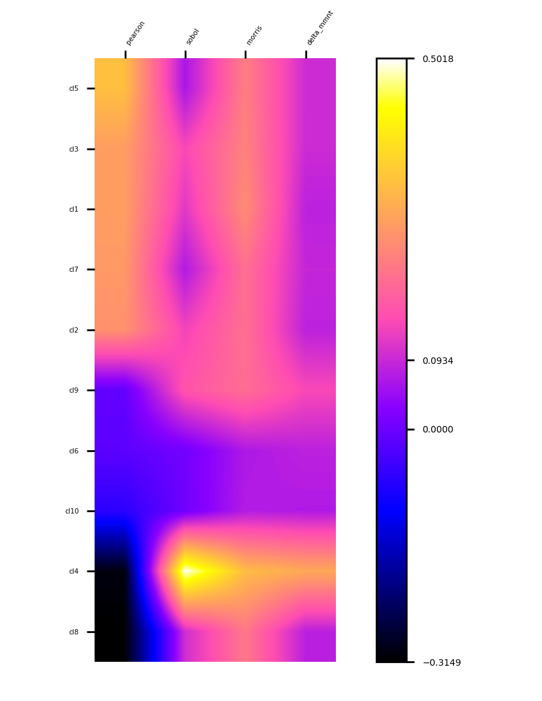
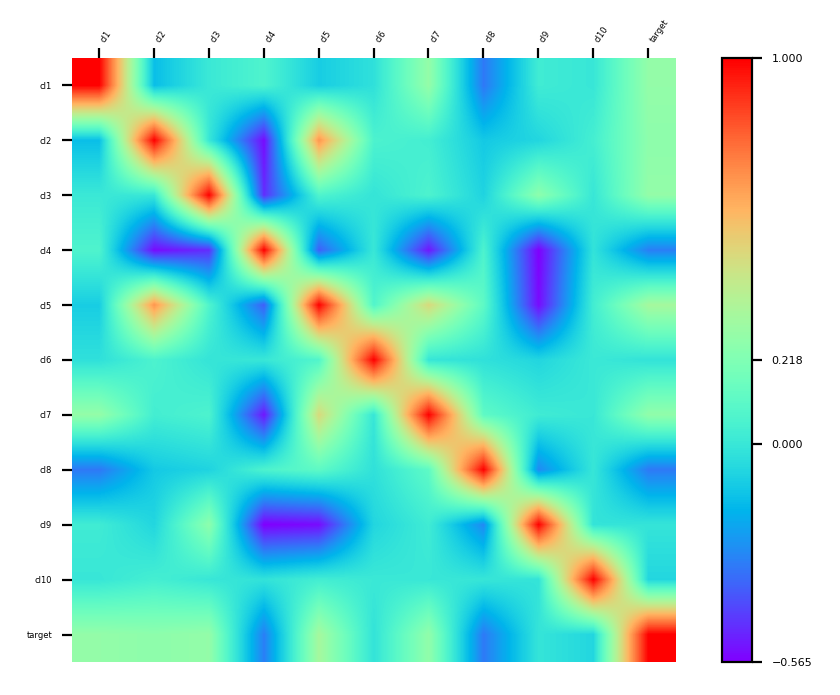

**Step 3.** Examine and log a random forest model and its metrics::

    from sklearn.ensemble import RandomForestClassifier
    from sklearn.model_selection import cross_val_score, ShuffleSplit
    # retrieve data
    X, y = MLTr.get_data()
    # init classifier
    clf = RandomForestClassifier(n_estimators=50)
    # log the classifier
    clf = MLTr.log_model(clf, "RandomForestClassifier(50)")
    # find the average metrics
    print(MLTr.log_metrics(clf, cv=ShuffleSplit(5, .25)))
    # {'accuracy': 0.8816, 'auc': 0.9504791437613562, 'precision': 0.9029848807772192,
    # 'f1': 0.8782525829634803, 'recall': 0.8554950898148654, 'mcc': 0.7640884799286114,
    # 'logloss': 4.089427586800243, 'variance': None, 'max_error': None, 'mse': None,
    # 'mae': None, 'r2': None}

For a bounded starting point, ``AML`` also provides explicit scikit-learn-only
presets. The classification preset uses accuracy; the regression preset uses
negative root mean squared error. Both search random forests and extremely
randomized trees in one-estimator pipelines, with a default budget of 20
evaluations per candidate. Users can override the candidate count, wall-clock
limit, scoring method, and pipeline length. With a pandas DataFrame and no
``cat_cols``, the preset automatically applies ``FoldLocalDataPreprocessor``
inside each CV fold, including numeric imputation, categorical encoding, and
per-column TF-IDF for ``StringDtype`` columns. Array-like input should already
be numeric. Supplying ``cat_cols`` selects the explicit categorical-encoding
path instead::

    from SKSurrogate import AML

    classifier = AML(preset="classification", time_limit=300, random_state=7)
    classifier.fit(X, y)

    regressor = AML(preset="regression", max_evals=30, random_state=7)
    regressor.fit(X_reg, y_reg)

These are deliberately small baseline searches, not quality guarantees.
``max_evals`` and ``time_limit`` apply per candidate pipeline; overall work
also depends on cross-validation folds and the number of candidates. Passing
``config=...`` continues to use the fully customizable search and cannot be
combined with ``preset``. Omitting both preserves the existing legacy default
search space.

By default, each ``AML.fit`` starts a fresh search rather than resuming a
checkpoint left by an earlier fit. Set ``AML(resume=True)`` only when you
intend to continue surrogate searches from their saved checkpoints.

``AML.fit`` accepts a pandas DataFrame directly; estimators that preserve their
input representation receive the original feature names. For categorical
columns, pass DataFrame column names or array column indices through
``cat_cols``. Categorical encoding is learned inside each CV training fold and
intentionally converts the encoded matrix to an array before estimator fitting.

**Step 4.** Search for best (in terms of accuracy) classifier as a combination of
``naive_bayes.GaussianNB``, ``linear_model.LogisticRegression``, ``lightgbm.LGBMClassifier``,
``preprocessing.StandardScaler``, and ``preprocessing.Normalizer``::

    from SKSurrogate import *
    # set up the confic dictionary
    config = {
        # estimators
        'sklearn.naive_bayes.GaussianNB': {
            'var_smoothing': Real(1.e-9, 2.e-1)
        },
        'sklearn.linear_model.LogisticRegression': {
            'penalty': Categorical(["l1", "l2"]),
            'C': Real(1.e-6, 10.),
            "class_weight": HDReal((1.e-5, 1.e-5), (20., 20.))
        },
        "lightgbm.LGBMClassifier": {
            "boosting_type": Categorical(['gbdt', 'dart', 'goss', 'rf']),
            "num_leaves": Integer(2, 100),
            "learning_rate": Real(1.e-7, 1. - 1.e-6),  # prior='uniform'),
            "n_estimators": Integer(5, 250),
            "min_split_gain": Real(0., 1.),  # prior='uniform'),
            "subsample": Real(1.e-6, 1.),  # prior='uniform'),
            "importance_type": Categorical(['split', 'gain'])
        },
        # preprocessing
        'sklearn.preprocessing.StandardScaler': {
            'with_mean': Categorical([True, False]),
            'with_std': Categorical([True, False]),
        },
        'sklearn.preprocessing.Normalizer': {
            'norm': Categorical(['l1', 'l2', 'max'])
        },
    }
    # initiate and perform the search
    A = AML(config=config, length=3, check_point='./sample/', verbose=1)
    A.eoa_fit(X, y, max_generations=15, num_parents=20)
    # retrieve and log the best
    eoa_clf = A.best_estimator_
    eoa_clf = MLTr.log_model(eoa_clf, "Best of EOA Surrogate Search")
    print(MLTr.log_metrics(eoa_clf, cv=ShuffleSplit(5, .25)))
    MLTr.preserve_model(eoa_clf)
    # {'accuracy': 0.8824, 'auc': 0.9207884992789751, 'precision': 0.8930688738450767,
    # 'f1': 0.8789651291713657, 'recall': 0.8664344690110679, 'mcc': 0.7657250436230718,
    # 'logloss': 4.061801043429923, 'variance': None, 'max_error': None, 'mse': None,
    # 'mae': None, 'r2': None}

For model selection that must remain separate from final evaluation,
``nested_cv_evaluation`` computes inner-CV scores and outer-fold estimates for
the supplied estimator, then evaluates it on the untouched validation partition.
It does not search among estimators or tune hyperparameters. Mixed-type
DataFrame features are preprocessed inside each training fold; unseen categories
are ignored at scoring time rather than being used to build the fold's category
vocabulary. Numeric DataFrames and arrays retain their direct numeric path. The
result identifies its preprocessing path and stores fold-level predictions and
metrics, mean outer scores, repeated-CV confidence intervals, and the final
validation score in task metadata. Group-aware splitters preserve group labels
through the evaluation path.

For ordered observations, callers can use ``TimeSeriesSplit`` for both
``inner_cv`` and ``outer_cv``. Keep rows in chronological order before
registering the partitions; SKSurrogate does not infer timestamps or sort rows.
Choose ``gap`` to exclude observations between each training and test window,
and construct lag, rolling, or forecast-horizon features without future-data
leakage before registration. Supply an explicit scikit-learn scorer when the
evaluation metric should differ from the estimator's default ``score`` method::

    from sklearn.metrics import get_scorer
    from sklearn.model_selection import TimeSeriesSplit

    result = tracker.nested_cv_evaluation(
        estimator,
        inner_cv=TimeSeriesSplit(n_splits=3, gap=2),
        outer_cv=TimeSeriesSplit(n_splits=4, gap=2),
        scoring=get_scorer("neg_mean_absolute_error"),
    )

The nested-CV API accepts these splitters as serialized specs, for example
``{"type": "TimeSeriesSplit", "n_splits": 4, "gap": 2}``, as well as integer
fold counts. This is splitter-level support: forecast target construction,
horizon-specific scoring, and time-aware feature engineering remain the
caller's responsibility.

The generic Python estimator path also works with scikit-learn's
``QuantileRegressor``. To evaluate the selected quantile, pass a matching
pinball-loss scorer; the scorer's ``alpha`` must match the estimator's
``quantile``::

    from sklearn.metrics import make_scorer, mean_pinball_loss
    from sklearn.linear_model import QuantileRegressor

    quantile = 0.8
    result = tracker.nested_cv_evaluation(
        QuantileRegressor(quantile=quantile),
        scoring=make_scorer(
            mean_pinball_loss,
            alpha=quantile,
            greater_is_better=False,
        ),
    )

For nested-CV API requests, set ``scoring`` to
``"neg_mean_pinball_loss"`` and provide ``pinball_alpha`` in the open interval
``(0, 1)``. The API requires this value explicitly so it can match the
estimator's ``quantile`` setting. Custom callable scorers remain available in
the Python API. The Evaluation page also offers pinball-loss learning curves
with an explicit quantile level and reports the loss in its natural positive
scale. Quantile-interval diagnostics are not integrated into the API or UI;
the Python interval helpers are documented below.

**Step 5.** Plot learning curves for accuracy, :math:`F_1`, area under ROC, calibration lift and
 cumulative curves for the two models::

    # the best of EOA Surrogate Search
    MLTr.plot_learning_curve(eoa_clf, "Best of Surrogate Search", cv=ShuffleSplit(5, .25), measure='accuracy')
    MLTr.plot_learning_curve(eoa_clf, "Best of Surrogate Search", cv=ShuffleSplit(5, .25), measure='f1')
    MLTr.plot_learning_curve(eoa_clf, "Best of Surrogate Search", cv=ShuffleSplit(5, .25), measure='roc_auc')
    MLTr.plot_calibration_curve(eoa_clf, "Best of Surrogate Search")
    MLTr.plot_cumulative_gain(eoa_clf, title="Best: Cumulative Gains Curve")
    MLTr.plot_lift_curve(eoa_clf, title="Best: Lift Curve")
    # Random Forest
    MLTr.plot_learning_curve(clf, "Random Forest", cv=ShuffleSplit(5, .25), measure='accuracy')
    MLTr.plot_learning_curve(clf, "Random Forest", cv=ShuffleSplit(5, .25), measure='f1')
    MLTr.plot_learning_curve(clf, "Random Forest", cv=ShuffleSplit(5, .25), measure='roc_auc')
    MLTr.plot_calibration_curve(clf, "Random Forest")
    MLTr.plot_cumulative_gain(clf, title="Random Forest: Cumulative Gains Curve")
    MLTr.plot_lift_curve(clf, title="Random Forest: Lift Curve")

Regression diagnostics
======================
For a single-target regressor, ``mltrack`` can report held-out summary
metrics and save a four-panel diagnostic plot. Both methods reuse the same
cached 75/25 split used by the other model plots::

    summary = MLTr.regression_diagnostics(regressor)
    print(summary)
    MLTr.plot_regression_diagnostics(regressor, title="Material strength")

The summary includes sample count, mean absolute error, root mean squared
error, :math:`R^2`, and residual mean and sample standard deviation. The plot
shows predicted versus actual values, residuals versus predictions, a residual
histogram, and a normal Q-Q plot. These are descriptive diagnostics on one
held-out split; they do not provide confidence intervals or prove that
residuals are normally distributed. Multi-output regression is not currently
supported. For model comparison and uncertainty across repeated evaluations,
use ``nested_cv_evaluation`` rather than treating a single split as definitive.

For paired comparisons, evaluate both estimators with the same repeated-CV
protocol and compare their result dictionaries::

    comparison = MLTr.compare_repeated_cv_results(
        reference_results, candidate_results, random_state=7
    )

The result reports the candidate-minus-reference mean and median repeat-score
difference, a percentile bootstrap interval, and paired Cohen's :math:`d_z`.
At least two aligned repeat scores are required. Results from
``nested_cv_evaluation`` include an evaluation protocol with registered
partition fingerprints, CV splitter specifications, repeat seed policy,
preprocessing path, scoring identity, and validation-set use. When both inputs
carry that protocol, known mismatches are rejected and the result reports
whether alignment could be verified. Default estimator scoring, opaque custom
scorers, missing partition fingerprints, and older result dictionaries remain
explicitly unverified; the caller must verify those cases. Since repeated CV
repeats reuse observations and training sets, the interval summarizes variation
across repeats; it is not an independent-sample significance test.

For uncertainty-aware single-target regression, use split conformal prediction
with disjoint training and calibration partitions::

    interval = split_conformal_regression_interval(
        regressor,
        X_train, y_train,
        X_calibration, y_calibration,
        X_test,
        alpha=0.1,
    )
    lower, upper = interval["lower"], interval["upper"]

The estimator is cloned and fitted only on the training data. Absolute
calibration residuals determine the finite-sample corrected interval width;
test labels are not accepted. The marginal coverage guarantee assumes the
calibration and future examples are exchangeable and that the fitted model was
chosen independently of the calibration set. Use a separate untouched test
set to measure empirical coverage; coverage is not guaranteed under
distribution shift.

To summarize intervals after collecting held-out labels, use
``prediction_interval_diagnostics``::

    diagnostics = prediction_interval_diagnostics(
        y_holdout,
        lower,
        upper,
        alpha=0.1,
        confidence_level=0.95,
        groups=holdout_groups,
        max_groups=20,
    )

It reports nominal and empirical coverage, a Wilson score interval for the
empirical coverage, mean and median width, and the mean Winkler score for a
central two-sided interval. The Wilson interval assumes independent held-out
coverage indicators; it describes finite-sample uncertainty and is not the
split-conformal guarantee. Unbounded intervals are retained in the coverage
calculation, but mean width and interval score are ``None`` if any interval is
unbounded.
Optional ``groups`` adds bounded per-group coverage counts and Wilson
intervals; missing group labels are excluded and categories beyond
``max_groups`` are combined. Small-group estimates can be highly uncertain,
and marginal conformal coverage does not imply conditional or subgroup
coverage. The registered bundle-interval endpoint accepts ``group_by`` to
request the same diagnostic on a holdout feature.

For two trained-on-training-partition quantile estimators, conformalized
quantile regression adjusts interval width using a disjoint calibration
partition::

    interval = split_conformal_quantile_interval(
        lower_quantile_estimator, upper_quantile_estimator,
        X_train, y_train,
        X_calibration, y_calibration,
        X_test,
        alpha=0.1,
    )
    lower, upper = interval["lower"], interval["upper"]

The estimators should represent lower and upper conditional quantiles
(commonly ``alpha / 2`` and ``1 - alpha / 2``). Predicted bounds are ordered
before calibration and application. The finite-sample corrected score can
expand or contract the base interval; a negative correction can make a
prediction set empty when the corrected lower bound exceeds the upper bound.
The result includes ``empty_interval_mask`` so callers can identify these
cases without changing the conformal prediction set. The correction is
infinite when the requested rank exceeds the calibration size. As with split conformal regression, the
marginal coverage claim assumes exchangeable calibration/future examples and
estimators selected independently of the calibration set. It does not imply
conditional coverage or protect against distribution shift.

Model explanations
==================
``permutation_importance`` provides a global model-attribution diagnostic
using the estimator's score by default (or an explicit scikit-learn scorer) and
returns the score drops, repeat-level values, and reference-set metadata::

    importance = MLTr.permutation_importance(
        regressor,
        features=["temperature", "pressure"],
        n_repeats=8,
        max_samples=1000,
        random_state=7,
    )
    print(importance["importances"])
    MLTr.plot_permutation_importance(regressor, features=["temperature", "pressure"])

The default reference is the cached 25% holdout created by
``mltrack.split_train``; that split is reused per logged model and is not
seeded by this API. Set ``reference_partition`` to use a separately registered
partition such as ``"test"``. At most 1,000 rows are used by default; any
additional row sampling is without replacement and controlled by
``random_state``. The result records the reference source, partition, row
counts, sampling limit, and seed. Wide datasets are not silently truncated:
the default limit is 100 features, and larger inputs require an explicit
``features`` selection. ``max_features`` can adjust this computational bound.

``plot_partial_dependence`` uses scikit-learn's partial-dependence display for
explicitly selected one- or two-feature profiles::

    MLTr.plot_partial_dependence(
        regressor,
        ["temperature", "pressure"],
        kind="both",
        max_samples=1000,
        ice_samples=100,
        random_state=7,
    )
    MLTr.plot_partial_dependence(
        regressor, [("temperature", "pressure")], kind="average"
    )

The reference and row-sampling defaults match permutation importance. At most
six profiles are plotted per call, and ICE curves are capped at 100 per
one-dimensional feature by default. Two-feature interactions show average
partial dependence only, so request ``kind="average"`` when selecting a pair.
Registered non-numeric columns are treated as categorical features. Both
explanation methods save their plots in the tracker. Permutation importance
attributes changes in the chosen model score to shuffling a feature; it is not
predictive association measured directly from the data. Partial dependence is
a fitted-model response profile, not an estimate of an intervention or causal
effect. Feature dependence, the selected reference population, and sampling
can all change the apparent attribution or profile. These APIs do not promise
stability across resamples.

Accumulated local effects (ALE) are a possible alternative to partial
dependence when correlated features make its marginal grid unrealistic: ALE
accumulates local prediction differences over observed feature intervals,
reducing reliance on predictions far outside the joint reference distribution.
It still describes model behavior rather than causality and does not solve
sparse-support or conditional-explanation problems automatically. The current
explanation API does not expose ALE. A supported implementation needs an
explicit contract for numeric versus categorical features, empty or sparse
bins, classifier output scale, and stability under the bounded reference-set
sampling policy before replacing or supplementing the existing profiles.

``plot_roc_curve`` supports multiclass classifiers with one-vs-rest curves for
each class and a micro-average curve. ``plot_calibration_curve`` similarly
reports one-vs-rest curves and probability distributions for each class; both
require the held-out split to contain examples from every fitted class.
Cumulative-gain and lift charts remain binary-only because they require a
single positive-class ranking.

*The Best of EOA*

|plt1| |plt2|
|plt3| |plt4|
|plt5| |plt6|

*Random Forest*

|plt7| |plt8|
|plt9| |plt10|
|plt11| |plt12|

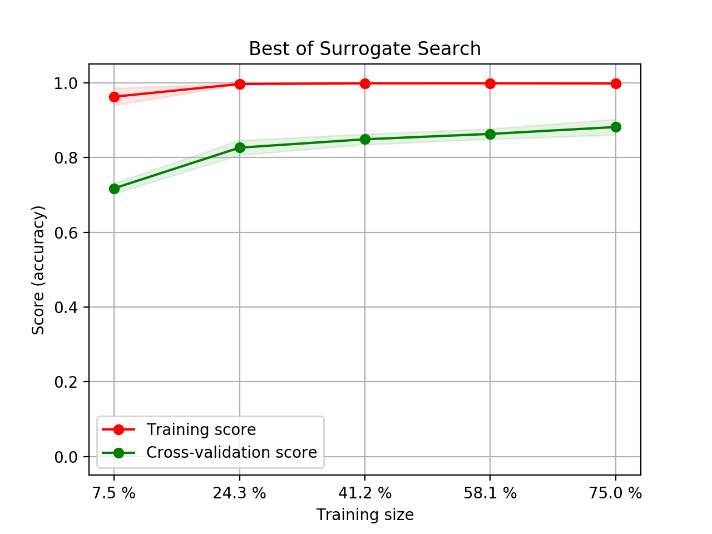
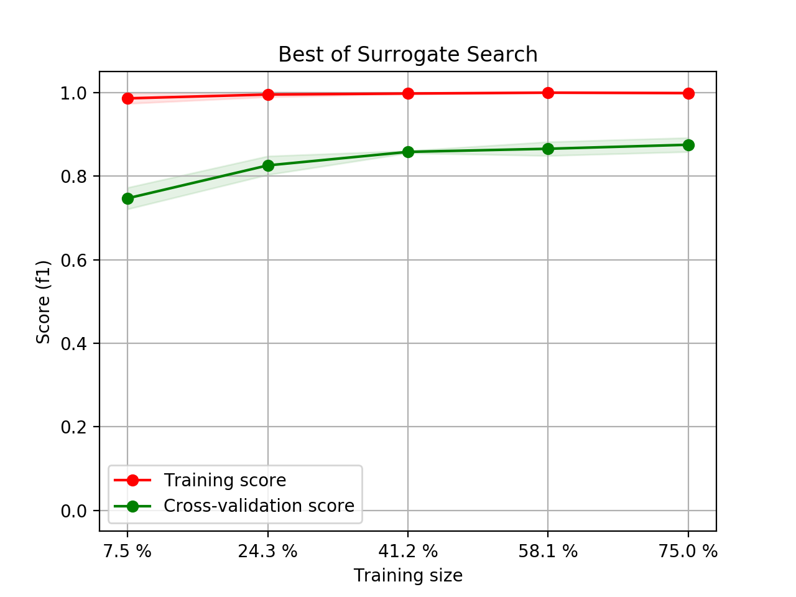
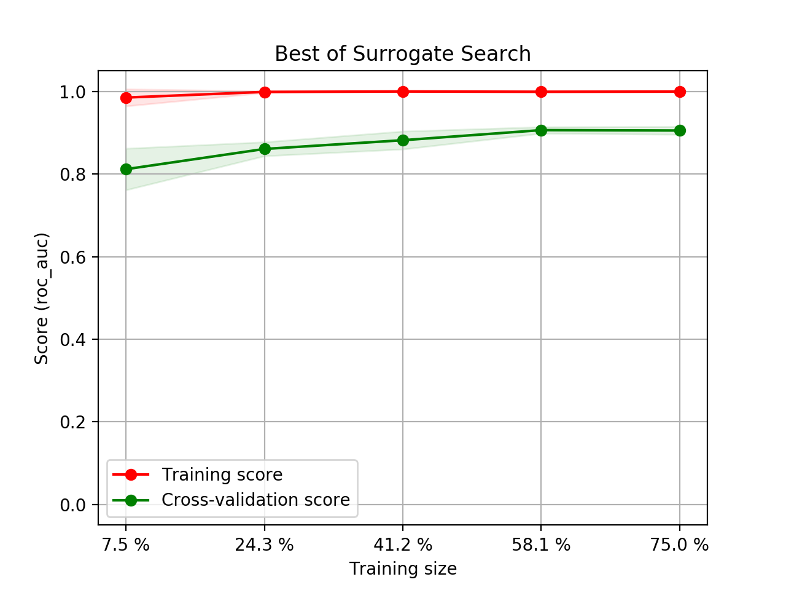
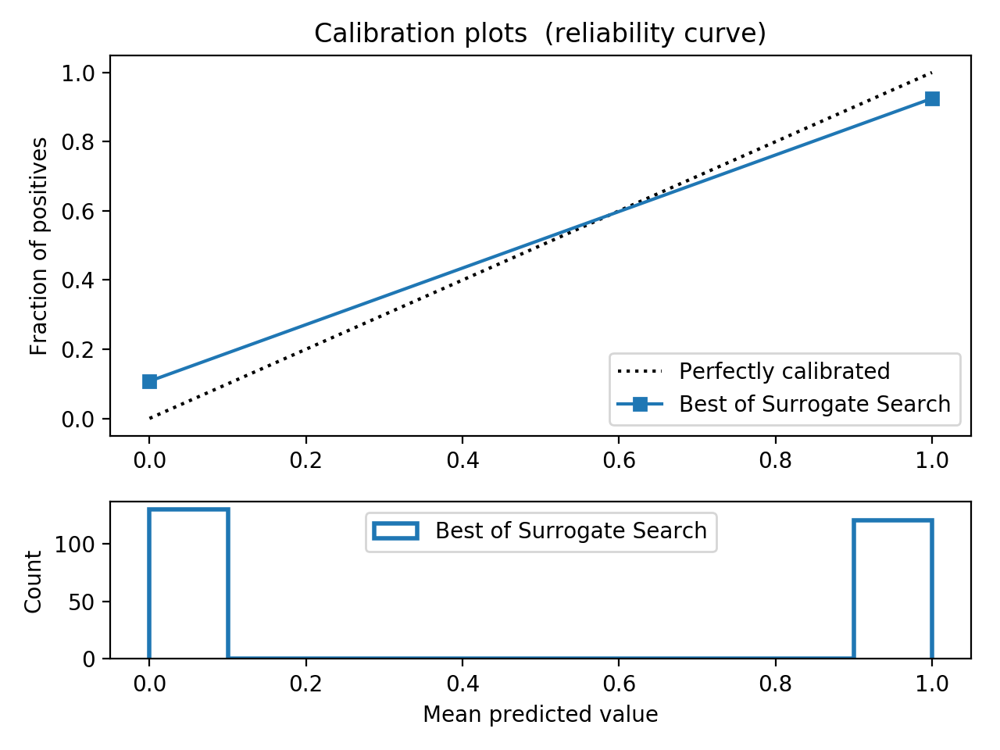
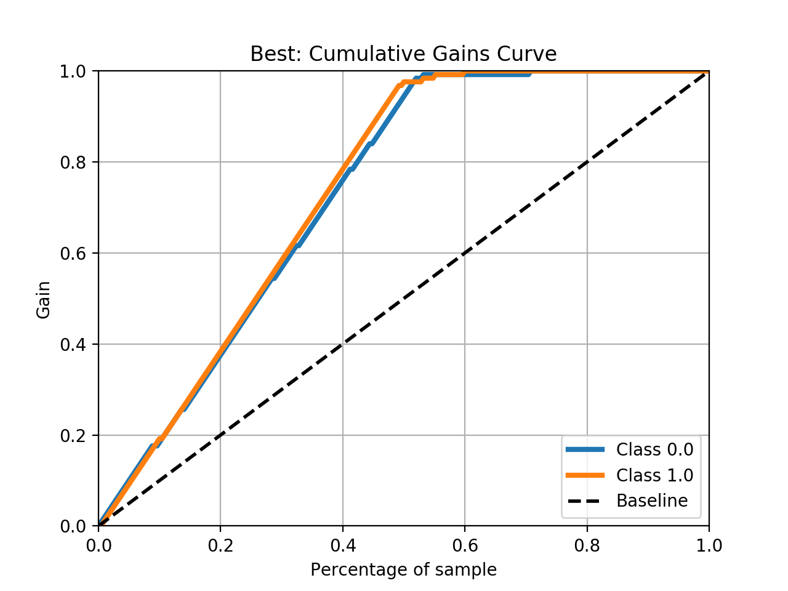
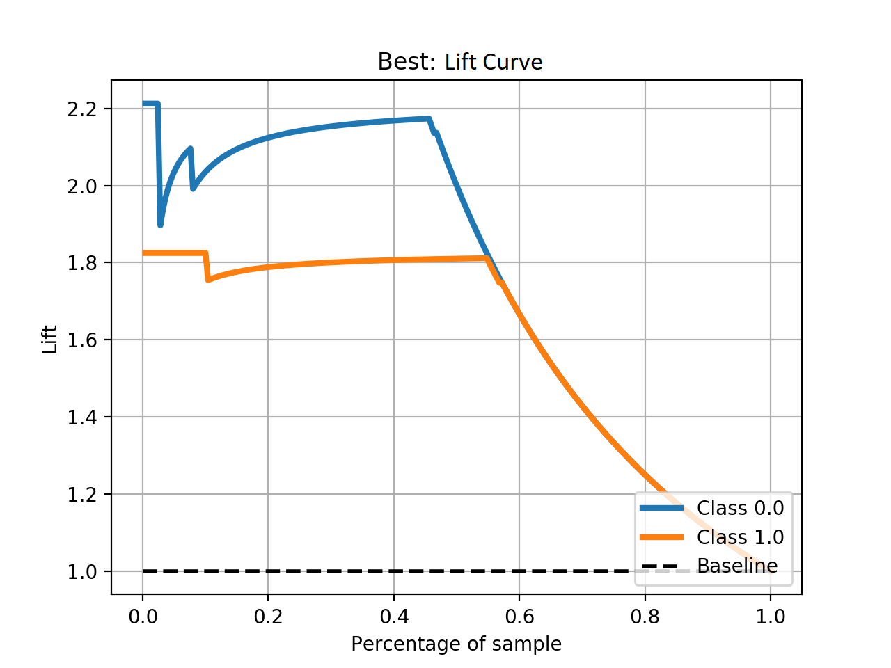
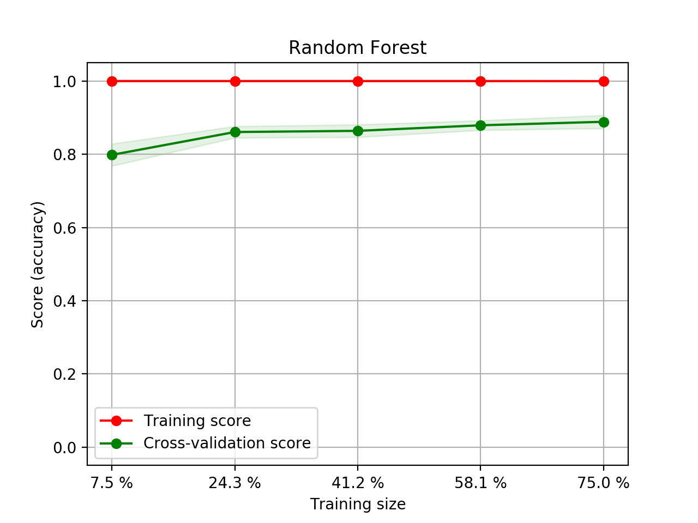
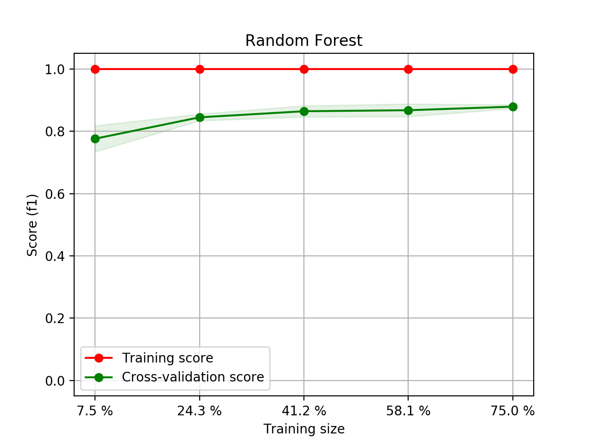
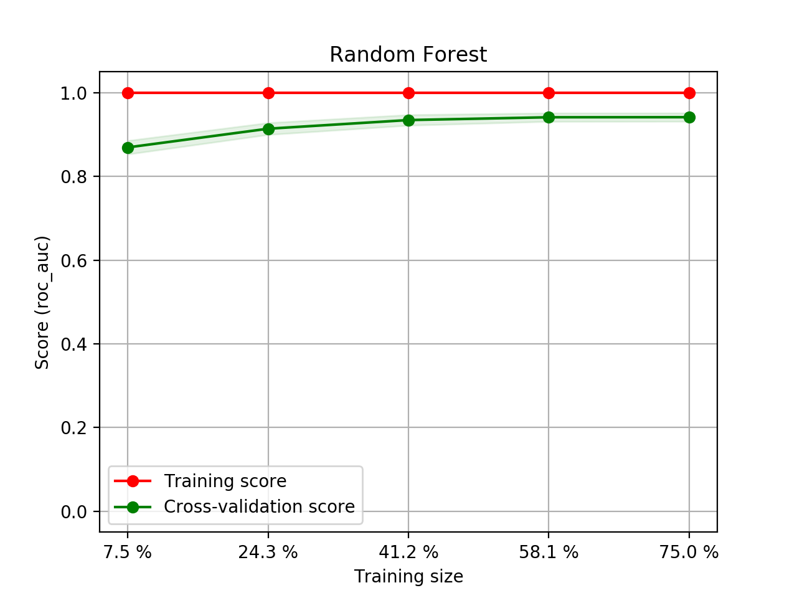
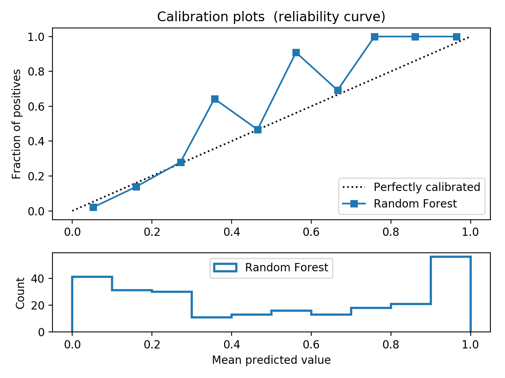
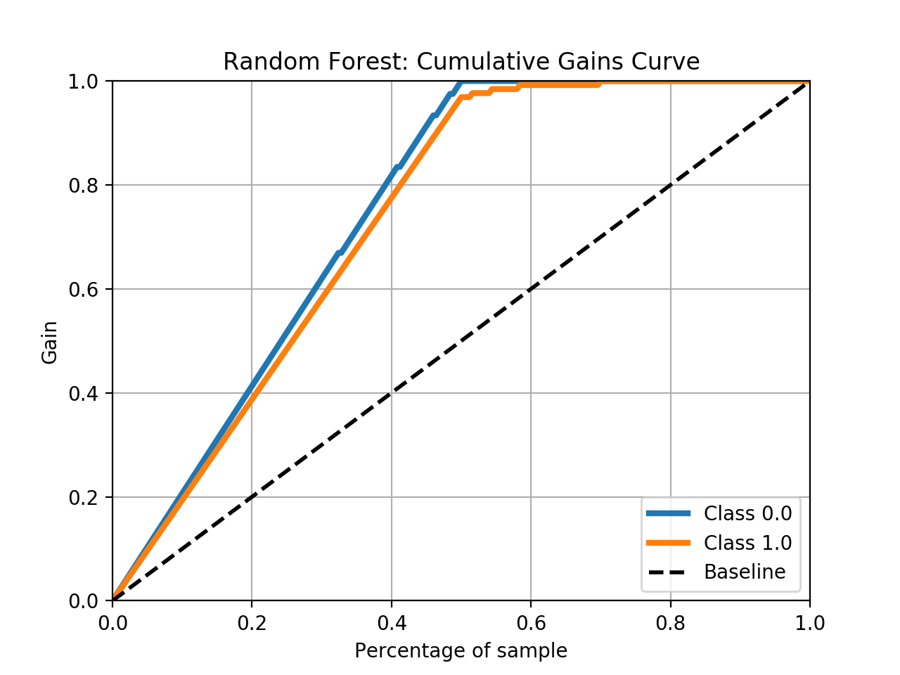
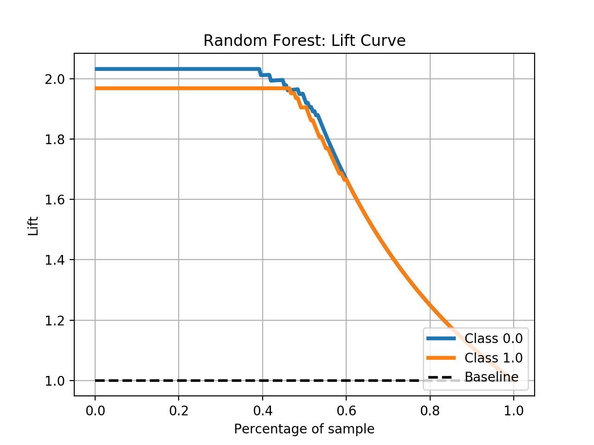

SVM Classifier with RBF v.s. SGDClassifier with Kernels
==========================================================
We try to see whether SVM classifiers with RBF kernel and SGDClassifres with kernel can compare.
We set up a quick ``SKSurrogate`` search with ``SVC`` and `NuSVC` as classifiers and another
quick ``SKSurrogate`` search over ``SGDClassifier``, ``Nystroem`` and ``RBFSampler`` kernels::

    import numpy as np
    from SKSurrogate import *
    import warnings
    warnings.filterwarnings("ignore", category=Warning)

    from sklearn.model_selection import RandomizedSearchCV
    from sklearn.kernel_ridge import KernelRidge
    from sklearn.gaussian_process.kernels import Matern, Sum, ExpSineSquared
    param_grid_krr = {"alpha": np.logspace(-4, 0, 5),
                      "kernel": [Sum(Matern(), ExpSineSquared(l, p))
                                 for l in np.logspace(-2, 2, 10)
                                 for p in np.logspace(0, 2, 10)]}
    regressor = RandomizedSearchCV(KernelRidge(), param_distributions=param_grid_krr, n_iter=7, cv=2)

    config = {
        # estimators
        'sklearn.svm.SVC': {
            "C": Real(1e-6, 20.),
            "gamma": Real(1e-6, 10.),
            "tol": Real(1e-6, 10.),
            "class_weight": HDReal((1.e-5, 1.e-5), (20., 20.))
        },
        'sklearn.svm.NuSVC': {
            'nu': Real(1.e-5, 1.),
            "gamma": Real(1e-6, 10.),
            "tol": Real(1e-6, 10.),
            "class_weight": HDReal((1.e-5, 1.e-5), (20., 20.))
        },
        # preprocessing
        'sklearn.preprocessing.StandardScaler': {
            'with_mean': Categorical([True, False]),
            'with_std': Categorical([True, False]),
        },
        'sklearn.feature_selection.VarianceThreshold': {
            'threshold': Real(0., .3)
        },
        'sklearn.preprocessing.Normalizer': {
            'norm': Categorical(['l1', 'l2', 'max'])
        },
    }

    MLTr = mltrack('sample', db_name="sample.db")
    X, y = MLTr.get_data()

    A_svm = AML(config=config, length=3, check_point='./svm/', verbose=1)
    A_svm.eoa_fit(X, y, max_generations=10, num_parents=10)
    print(A_svm.get_top(4))

Which results in::

    OrderedDict([(('sklearn.feature_selection.VarianceThreshold',
               'sklearn.preprocessing.Normalizer',
               'sklearn.svm.SVC'),
              (Pipeline(memory=None,
                    steps=[('stp_0', VarianceThreshold(threshold=0.20066923736000097)), ('stp_1', Normalizer(copy=True, norm='l2')), ('stp_2', SVC(C=15.110221076172207, cache_size=200,
                 class_weight={0.0: 13.581338880577112, 1.0: 3.1546898782179706},
                 coef0=0.0, decision_function_shape='ovr', degree=3, gamma=10.0,
                 kernel='rbf', max_iter=-1, probability=False, random_state=None,
                 shrinking=True, tol=1e-06, verbose=False))]),
               -0.9253333333333333)),
             (('sklearn.preprocessing.StandardScaler',
               'sklearn.preprocessing.Normalizer',
               'sklearn.svm.SVC'),
              (Pipeline(memory=None,
                    steps=[('stp_0', StandardScaler(copy=True, with_mean=True, with_std=False)), ('stp_1', Normalizer(copy=True, norm='l1')), ('stp_2', SVC(C=14.396152757785778, cache_size=200,
                 class_weight={0.0: 11.644799650485178, 1.0: 14.834346896165036},
                 coef0=0.0, decision_function_shape='ovr', degree=3,
                 gamma=1.387860853481898, kernel='rbf', max_iter=-1, probability=False,
                 random_state=None, shrinking=True, tol=1.3386685658572253, verbose=False))]),
               -0.9253333333333333)),
             (('sklearn.svm.NuSVC',
               'sklearn.preprocessing.Normalizer',
               'sklearn.svm.SVC'),
              (Pipeline(memory=None,
                    steps=[('stp_0', StackingEstimator(decision=True,
                        estimator=NuSVC(cache_size=200,
                  class_weight={0.0: 16.514247793012903, 1.0: 19.743755570932407},
                  coef0=0.0, decision_function_shape='ovr', degree=3,
                  gamma=2.879810799993445, kernel='rbf', max_iter=-1,
                  nu=5.366323874825201e-05, pr...robability=False,
                 random_state=None, shrinking=True, tol=0.0002612195258127529,
                 verbose=False))]), -0.9226666666666666)),
             (('sklearn.feature_selection.VarianceThreshold',
               'sklearn.preprocessing.Normalizer',
               'sklearn.svm.NuSVC'),
              (Pipeline(memory=None,
                    steps=[('stp_0', VarianceThreshold(threshold=0.10372588511430014)), ('stp_1', Normalizer(copy=True, norm='l2')), ('stp_2', NuSVC(cache_size=200,
                  class_weight={0.0: 4.756565216129669, 1.0: 14.36176825433476},
                  coef0=0.0, decision_function_shape='ovr', degree=3,
                  gamma=5.437271690133034, kernel='rbf', max_iter=-1,
                  nu=0.6557563687772239, probability=False, random_state=None,
                  shrinking=True, tol=2.1918030657741365, verbose=False))]),
               -0.9186666666666666)))])

And for ``SGDClassifier``::

    import numpy as np
    from SKSurrogate import *
    import warnings
    warnings.filterwarnings("ignore", category=Warning)

    from sklearn.model_selection import RandomizedSearchCV
    from sklearn.kernel_ridge import KernelRidge
    from sklearn.gaussian_process.kernels import Matern, Sum, ExpSineSquared
    param_grid_krr = {"alpha": np.logspace(-4, 0, 5),
                      "kernel": [Sum(Matern(), ExpSineSquared(l, p))
                                 for l in np.logspace(-2, 2, 10)
                                 for p in np.logspace(0, 2, 10)]}
    regressor = RandomizedSearchCV(KernelRidge(), param_distributions=param_grid_krr, n_iter=7, cv=2)

    config = {
        # estimators
        'sklearn.linear_model.SGDClassifier': {
            'loss': Categorical(['hinge', 'log', 'modified_huber', 'squared_hinge', 'perceptron']),
            'penalty': Categorical(['none', 'l2', 'l1', 'elasticnet']),
            'alpha': Real(1.e-5, .9999),
            'l1_ratio': Real(0., 1.),
            'tol': Real(1.e-5, 1.),
            'class_weight': HDReal((1.e-5, 1.e-5), (20., 20.))
        },
        # preprocessing
        'sklearn.preprocessing.StandardScaler': {
            'with_mean': Categorical([True, False]),
            'with_std': Categorical([True, False]),
        },
        'sklearn.feature_selection.VarianceThreshold': {
            'threshold': Real(0., .3)
        },
        'sklearn.preprocessing.Normalizer': {
            'norm': Categorical(['l1', 'l2', 'max'])
        },
        # Transformers
        'sklearn.kernel_approximation.Nystroem': {
            'kernel': Categorical(['rbf', 'poly', 'sigmoid']),
            'gamma': Real(1.e-6, 10.),
            'n_components': Integer(10, 120)
        },
        'sklearn.kernel_approximation.RBFSampler': {
            'gamma': Real(1.e-6, 10.),
            'n_components': Integer(10, 120)
        },
    }

    MLTr = mltrack('sample', db_name="sample.db")
    X, y = MLTr.get_data()

    A_sgd = AML(config=config, length=3, check_point='./svm/', verbose=2)#, cat_cols=[5])
    A_sgd.fit(X, y)
    print(A_sgd.get_top(4))

Which results in::

    OrderedDict([(('sklearn.linear_model.SGDClassifier',
                   'sklearn.kernel_approximation.Nystroem',
                   'sklearn.linear_model.SGDClassifier'),
                  (Pipeline(memory=None,
                        steps=[('stp_0', StackingEstimator(decision=True,
                            estimator=SGDClassifier(alpha=1.0186882143892309e-05, average=False,
                          class_weight={0.0: 1e-05, 1.0: 1e-05}, early_stopping=False,
                          epsilon=0.1, eta0=0.0, fit_intercept=True,
                          l1_ratio=0.16668760571866542, learning_rate='op...om_state=None, shuffle=True,
                          tol=1.0, validation_fraction=0.1, verbose=0, warm_start=False))]),
                   -0.8946666666666667)),
                 (('sklearn.preprocessing.Normalizer',
                   'sklearn.kernel_approximation.RBFSampler',
                   'sklearn.linear_model.SGDClassifier'),
                  (Pipeline(memory=None,
                        steps=[('stp_0', Normalizer(copy=True, norm='l1')), ('stp_1', RBFSampler(gamma=5.09346829872262, n_components=120, random_state=None)), ('stp_2', SGDClassifier(alpha=1e-05, average=False,
                          class_weight={0.0: 6.299501235657723, 1.0: 14.399482243823948},
                          early_stopping=False, epsilon=0.1,..._state=None, shuffle=True,
                          tol=1e-05, validation_fraction=0.1, verbose=0, warm_start=False))]),
                   -0.8946666666666667)),
                 (('sklearn.kernel_approximation.Nystroem',
                   'sklearn.preprocessing.Normalizer',
                   'sklearn.linear_model.SGDClassifier'),
                  (Pipeline(memory=None,
                        steps=[('stp_0', Nystroem(coef0=None, degree=None, gamma=7.102137254366565, kernel='poly',
                        kernel_params=None, n_components=51, random_state=None)), ('stp_1', Normalizer(copy=True, norm='l2')), ('stp_2', SGDClassifier(alpha=0.4030001737762923, average=False,
                          class_weight={0.0: 16.5900487...shuffle=True, tol=0.6700383879862661,
                          validation_fraction=0.1, verbose=0, warm_start=False))]),
                   -0.8906666666666667)),
                 (('sklearn.preprocessing.Normalizer',
                   'sklearn.kernel_approximation.Nystroem',
                   'sklearn.linear_model.SGDClassifier'),
                  (Pipeline(memory=None,
                        steps=[('stp_0', Normalizer(copy=True, norm='l2')), ('stp_1', Nystroem(coef0=None, degree=None, gamma=5.928661960771689, kernel='poly',
                        kernel_params=None, n_components=117, random_state=None)), ('stp_2', SGDClassifier(alpha=0.5112964074641659, average=False,
                          class_weight={0.0: 3.2816638...shuffle=True, tol=0.7276228102426916,
                          validation_fraction=0.1, verbose=0, warm_start=False))]),
                   -0.884))])

This shows a :math:`3.06\%` loss in accuracy