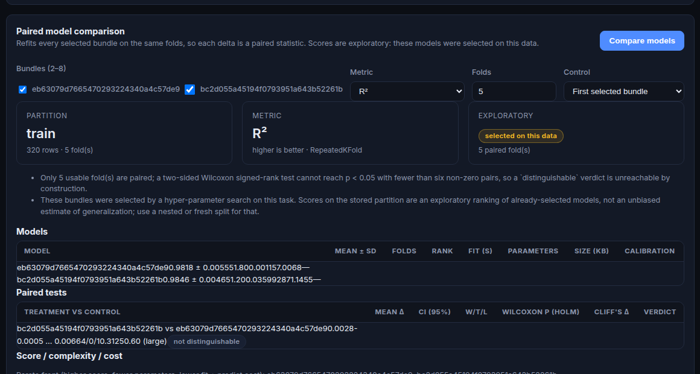

=========================
Paired model comparison
=========================

Stored bundles carry aggregate scores, but those aggregates cover **different
folds** per bundle. Subtracting them produces a number that looks like an
improvement and is not one: the two models were never scored on the same rows.
The comparison endpoint removes that ambiguity by refitting every selected
bundle's estimator on one materialised fold list, so every delta is a *paired*
statistic.

.. code-block:: sh

   curl -X POST http://127.0.0.1:8013/api/comparison/diabetes \
     -H 'content-type: application/json' \
     -d '{"model_versions": ["abc12345", "def67890"], "scoring": "r2", "n_splits": 5}'

   The comparison card after a run: per-model scores and cost, the paired test
   with its interval and Holm-adjusted p-value, and the exploratory warning above
   the table.

At least two and at most eight versions are accepted. A request naming one
version is refused with 400 rather than silently comparing a model with itself;
a version that does not exist is a 404; bundles from different problem families
(classification versus regression) are refused with 400 because their scores are
not on a common scale.

What is measured
================

Each request reports, per model:

* ``fold_scores`` — the raw score on every shared fold (null when a fold failed),
  plus ``score_mean``/``score_std`` over the finite ones;
* ``fit_time_s`` — mean fit seconds from the same cross-validation run;
* ``predict_time_ms`` — median per-row prediction latency of the fitted bundle;
* ``parameters`` — the number of numeric array elements the fitted estimator
  carries (a lower bound on complexity; see ``SKSurrogate.compare.fitted_parameter_count``);
* ``disk_bytes`` — the bundle file size, and its ``integrity`` verdict when a
  manifest sidecar exists;
* ``calibration`` for classifiers — the Brier score and expected calibration
  error computed from out-of-fold probabilities.

The statistics block contains one row per non-control model:

``mean_delta``, ``ci_low``/``ci_high``
    Mean oriented paired delta and its percentile bootstrap interval. Deltas are
    oriented so that **positive always means the treatment is better**; on a
    ``neg_*`` metric the sign is flipped accordingly and ``metric_direction`` in
    the payload names the convention.
``wins``/``ties``/``losses``
    How many folds the treatment won, tied and lost.
``wilcoxon_p``, ``p_adjusted``
    Two-sided Wilcoxon signed-rank p-value and its Holm step-down adjustment
    across the family of comparisons against the same control. Read the adjusted
    value; the raw p-values are dependent because they share a control.
``cliffs_delta``, ``cliffs_magnitude``
    Ordinal effect size ``(wins - losses) / n`` with the negligible/small/medium/
    large bands. It answers "how often does A beat B", not "by how much".
``distinguishable``
    True when the bootstrap interval excludes zero **and** the Holm-adjusted
    p-value is below ``alpha``. It is a descriptive, dependence-aware verdict on
    these folds — not a claim about a population of datasets.

Small samples are reported, not hidden. A two-sided Wilcoxon test cannot reach
``p < 0.05`` with fewer than six non-zero pairs, so with five folds no verdict
is reachable by construction; the response says so in ``warnings`` instead of
presenting an undecidable comparison as a tie.

Trade-off axis
==============

``trade_off`` puts every comparable model on (score, complexity, cost):

* score — ``score_mean``, minimised internally after orientation;
* complexity — ``parameters``;
* cost — ``1000 * fit_time_s + predict_time_ms``.

``pareto_frontier`` lists the non-dominated models, ``dominated`` names one
witness per dominated model, and ``incomplete`` names models missing an
objective (a model cannot be ranked on a dimension it does not report).
``simpler_within_tolerance`` answers the practical question — *which is the
simplest model whose score is within δ of the best?* — with δ in the metric's
own units. A percentage-of-best rule is deliberately avoided: it is undefined
around zero and rewards a worse run on a negative metric.

Rank stability
==============

``stability`` ranks the models on every fold (1 = best, ties averaged) and
reports each model's mean rank, rank SD, number of best folds and
``rank_consistency`` — the share of folds on which it holds its modal rank.
``unstable`` is true below 0.5. This is a descriptive summary: two folds
disagreeing is information, not an error.

Exploratory, not unbiased
=========================

Every compared estimator was selected by a hyper-parameter search **on this
task's data**. Reusing the stored partition keeps the comparison paired but also
reuses the selection, so the ranking is exploratory. The payload states this in
``score_provenance`` (``exploratory: true``, ``selected_on_same_data: true``) and
repeats it in ``warnings``; the Evaluation page renders the warning above the
table. An unbiased comparison needs a fresh holdout or a nested-CV estimate, as
:doc:`ensembles` describes for ensembles.

Calibration convention
======================

``calibration.brier_score`` is the *multiclass* Brier score: the mean over rows
of the sum of squared errors across classes, in ``[0, 2]``. For binary data this
is twice the ``sklearn.metrics.brier_score_loss`` convention, so do not compare
the two numbers directly. ``expected_calibration_error`` uses ten equal-width
confidence bins on the top-label prediction; it is descriptive and bin-count
dependent, not a calibration test.

Python API
==========

The statistics are usable without the control plane:

.. code-block:: python

   from SKSurrogate.compare import compare_scores, pareto_frontier, rank_stability

   report = compare_scores(
       {
           "baseline": [0.70, 0.72, 0.71, 0.69, 0.73, 0.70],
           "candidate": [0.75, 0.77, 0.76, 0.74, 0.78, 0.75],
       },
       control="baseline",
   )
   report["comparisons"][0]["distinguishable"]  # True

The module depends only on NumPy and SciPy; it never imports scikit-learn, so
the core stays installable without the platform.
