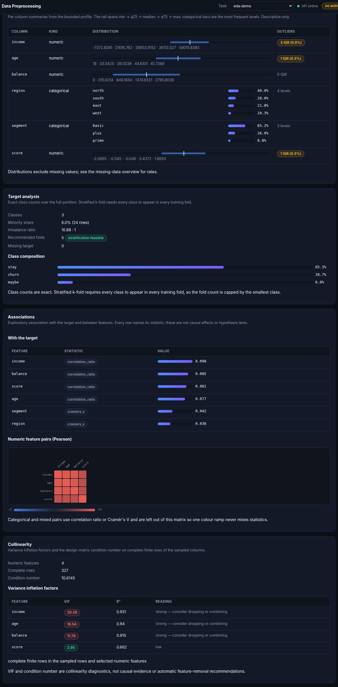
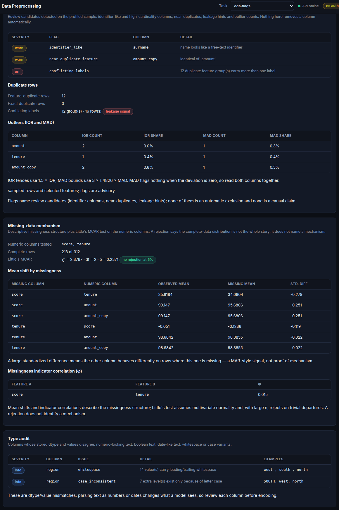
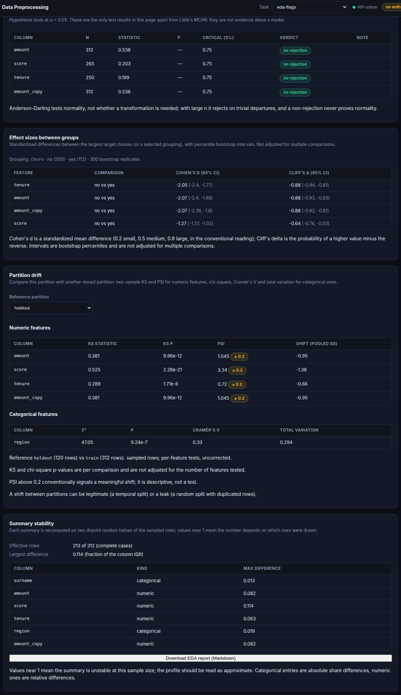

====================
Drift Monitoring
====================

``drift_report`` compares a reference training or validation DataFrame with current
tabular data. It keeps schema and data-quality changes separate from statistical
distribution drift and returns a JSON-safe report suitable for logging or alerting.

.. code-block:: python

    from SKSurrogate import drift_report

    report = drift_report(
        reference_train,
        current_batch,
        model_version="customer-churn-v3",
        reference_dataset_fingerprint="train-fingerprint",
        current_dataset_fingerprint="batch-fingerprint",
        psi_threshold=0.2,
        categorical_threshold=0.2,
        missingness_threshold=0.1,
        range_threshold=0.1,
    )

Report sections
===============

* ``schema_changes`` lists missing columns, extra columns, reordered columns, and
  dtype changes.
* ``data_quality`` records row counts and per-column reference/current missingness
  rates and deltas.
* ``drift.numeric`` reports population stability index (PSI) values and reference
  quantile bins for numeric features.
* ``drift.categorical`` reports total variation distance and both categorical
  distributions.
* ``drift.range`` reports the reference min/max, current min/max, and the current
  out-of-reference-range rate for numeric features.
* ``alerts`` contains threshold crossings with their type, column, and measured value.
* ``model_version`` and dataset fingerprints identify the deployment and datasets
  associated with the report.

Schema changes and missingness are reported even when a column cannot be compared for
distribution drift. Numeric PSI uses reference-derived quantile bins; categorical drift
includes values observed only in the current data. Thresholds are configurable per
report, and the default values are available under ``report["thresholds"]``.

Range drift is reported for numeric features as the current out-of-reference-range
rate. Use ``prediction_distribution_report`` for prediction drift, and
``delayed_label_performance`` when labels arrive after inference:

.. code-block:: python

    from SKSurrogate import delayed_label_performance, prediction_distribution_report

    prediction_report = prediction_distribution_report(
        reference_predictions, current_predictions, model_version="model-v3"
    )
    performance = delayed_label_performance(
        predictions, delayed_labels, model_version="model-v3"
    )

For regression tasks, pass ``task_type="regression"`` to receive delayed-label MAE
and MSE instead of classification accuracy. Prediction drift supports numeric and
categorical prediction values and uses the same thresholded alert format as feature
drift.

Governance and fairness checks
==============================

Bounded dataset profiling
=========================

Use ``dataset_profile`` before model search to inspect mixed-type distributions,
missingness, target associations, and highly associated feature pairs:

.. code-block:: python

    from SKSurrogate import dataset_profile

    report = dataset_profile(
        frame,
        target="outcome",
        max_rows=5000,
        max_features=50,
        max_categories=10,
        random_state=0,
    )

Numeric columns include finite-value summaries and a separate count of positive
or negative infinity values, median absolute deviation, standardized skewness
and excess kurtosis, and IQR-fence outlier counts, rates, and fences. These
outlier flags are descriptive signals, not evidence that a row is erroneous.
Other columns include bounded frequency summaries; categorical target
frequencies can help reveal class balance. Target and feature-pair associations
use Pearson correlation for numeric pairs, correlation ratio for mixed pairs,
and Cramer's V for categorical pairs. Pairwise feature associations are sorted
by strength to help prioritize redundancy checks.

For numeric pairs, ``rank_associations`` additionally reports Spearman and
Kendall rank coefficients on complete finite pairs, alongside pair counts.
These describe monotonic rank association and complement (but do not replace)
Pearson's linear correlation. They are descriptive coefficients, not
hypothesis tests, and do not detect all forms of nonlinear dependence.

The ``multicollinearity`` section reports per-feature variance inflation
factors (VIF) and a standardized design-matrix condition number for selected
numeric features. Both use complete finite rows from the profile sample.
Constant features are not assigned a VIF, and rank-deficient designs report a
null condition number with a reason rather than infinity. These are
diagnostics—not causal evidence or automatic feature-removal recommendations.

The ``data_quality`` section reports constant and all-missing selected
features, exact duplicate selected features, and duplicate rows. Duplicate-row
counts apply only to the sampled rows and selected features; duplicate-feature
checks compare exact values over those same sampled rows. All profile
statistics are descriptive and, when row sampling is used, apply to that
deterministic sample rather than the complete dataset.

The ``missingness_patterns`` section counts exact combinations of missing
selected features, reports the most common patterns up to ``max_categories``,
and aggregates the remaining rows into ``other_count``. It describes patterns
in the sampled rows only; it does not test whether missingness is associated
with observed values or outcomes.

For descriptive numeric distributions across categories, include the
categorical grouping feature in ``features`` and pass ``group_by``::

    report = dataset_profile(
        frame,
        target="outcome",
        features=["condition", "temperature"],
        group_by="condition",
        max_categories=10,
    )

The ``group_comparisons`` output contains per-group sample sizes, missing and
non-finite counts, and numeric distribution summaries for the selected numeric
features and numeric target. Missing group labels are excluded; categories
beyond the top ``max_categories`` are combined into an ``Other (combined)``
group. This is descriptive only: it does not run hypothesis tests, estimate
causal effects, or correct for multiple comparisons. Group summaries share the
profile's sampled-row scope. The registered-partition profile endpoint accepts
the same ``group_by`` option.

The helper samples without replacement when the row limit is exceeded. If a
dataset has more features than ``max_features``, select the features explicitly
instead of silently truncating them. ``POST /api/datasets/{task_name}/profile``
profiles a registered partition (``train`` by default), infers the target from
registration metadata when available, and accepts the same row, feature, and
category bounds. Its response includes the registered partition fingerprint.
API limits are at most 10,000 rows, 100 features, and 50 categories.

EDA in the Data page
--------------------

``GET /api/datasets/{task_name}/{partition}/preprocessing`` backs the Data
Preprocessing page and forwards the profile blocks that describe a registered
partition, so the page can show distributions, associations and collinearity
without a second request:

* ``column_profiles`` — the per-column profile entries (kind, missingness,
  cardinality, constant/all-missing flags, quantile or frequency distribution);
* ``target_associations`` / ``feature_associations`` — ranked association
  entries, each naming its statistic (``pearson``, ``correlation_ratio``,
  ``cramers_v``). Feature-pair rows are capped at ``association_limit`` (200)
  and the response reports ``feature_associations_truncated`` rather than
  silently dropping pairs;
* ``rank_associations`` — Spearman and Kendall coefficients for numeric pairs;
* ``multicollinearity`` — VIF rows and the standardized condition number;
* ``target_composition`` — exact target counts over the **full** partition.
  Classification targets report class counts, minority share, imbalance ratio
  and ``recommended_folds`` (``min(5, smallest class)`` plus a
  ``stratification_feasible`` flag). Numeric targets report counts and the
  bounded profile's shape statistics; a two-valued numeric column carries
  ``binary_like`` so a 0/1 float target is not presented as a regression target.

   Distributions, target composition, associations and collinearity cards on
   the Data Preprocessing page.

The association heatmap deliberately contains numeric (Pearson) pairs only:
correlation ratio and Cramer's V live on different scales and must not share one
colour ramp. Every card states its scope — sampled rows versus the full
partition — and none of these statistics is a causal claim or a hypothesis test.

Data-quality flags, missingness mechanism and type audit
--------------------------------------------------------

The same overview response carries three further blocks, computed by
``api/eda.py``:

* ``quality_flags`` — review candidates with a severity, a column and a detail:

  - ``identifier_like``: a text column whose distinct-value ratio is at least
    0.95, a name that looks like an identifier (``id``, ``uuid``, ``key``,
    ``row``, ``index``), a free-text name hint (``name``, ``surname``,
    ``email``, …) combined with high cardinality, or a numeric column that is a
    consecutive integer row index. Continuous measurements are **not** flagged.
  - ``high_cardinality``: a text column whose distinct-value ratio is at least
    0.5 — one-hot encoding it will be wide.
  - ``quasi_constant``: one level covers at least 95 % of non-missing rows.
  - ``near_duplicate_feature``: identical columns, columns equal after rounding,
    or numeric pairs with ``|r| >= 0.999``.
  - leakage hints: a target association with ``|value| >= 0.98``, a feature that
    is constant inside a class, and class ranges that do not overlap.
  - ``conflicting_labels``: duplicate feature rows that carry more than one
    target value — the cross-validation leakage signal.

  The block also reports IQR (1.5 × IQR fences) **and** MAD (3 × 1.4826 × MAD)
  outlier counts per numeric column, plus the duplicate-row counts. Thresholds
  are returned in ``thresholds``.

* ``missing_mechanism`` — missing-versus-observed mean shifts (a MAR-style
  signal across numeric columns), pairwise missingness-indicator correlations
  (φ), and **Little's MCAR test**. The test fits multivariate-normal parameters
  by EM and compares each missingness pattern's observed means with the ML
  estimates:

  .. math::

      d^2 = \sum_j n_j (\bar y_j - \hat\mu_j)^\top \hat\Sigma_{jj}^{-1}
            (\bar y_j - \hat\mu_j), \qquad
            \mathrm{df} = \sum_j p_j - p .

  It returns ``reason`` instead of a statistic when the test is not applicable
  (no missing values, fewer than two columns with missingness, too few rows,
  singular covariance, non-convergence). A rejection does not name a mechanism,
  and with large ``n`` it rejects on trivial departures.

* ``type_audit`` — numeric-looking text, mixed-type columns, boolean-like text,
  date-like text, leading/trailing whitespace, and levels that differ only by
  letter case. Each issue carries up to three example values.

   Identifier, near-duplicate and conflicting-label flags with IQR/MAD outlier
   counts; Little's MCAR statistic with mean shifts; and dtype/value mismatches.

All three blocks are bounded (5,000 sampled rows for flags, 2,000 for the
missingness and type blocks, at most 12 numeric columns in the formal test) and
none of them modifies the partition. The one formal test is labelled as such;
everything else is a descriptive signal for review.

Formal tests, effect sizes, partition drift and stability
---------------------------------------------------------

Three more blocks travel with the overview response and one route adds a
cross-partition comparison:

* ``formal_tests`` — Anderson–Darling normality test per numeric feature column.
  The test reports the statistic and the **tabulated critical value nearest the
  requested α** (0.751 at 5 % for the normal case) plus the rejection verdict. A
  p-value is intentionally not reported on this code path: SciPy's
  ``method="interpolate"`` returns a value capped at the smallest tabulated
  significance (0.15), which reads like a p-value and is not one. The response's
  ``caveat`` states that a rejection at large ``n`` can be trivial and that a
  non-rejection never proves normality.
* ``effect_sizes`` — Cohen's d and Cliff's δ between the largest target classes
  (or an explicit grouping), each with a percentile bootstrap interval:

  .. math::

      d = \frac{\bar x_A - \bar x_B}{s_p}, \qquad
      \delta = \frac{2U}{n_A n_B} - 1 .

  ``δ`` is computed from the Mann–Whitney statistic, so point estimates and
  bootstrap replicates are ``O(n log n)`` rather than pairwise ``O(n^2)``.
  Intervals are per comparison and uncorrected; a numeric target refuses the
  block with ``reason = "grouping_column_is_numeric"`` instead of inventing
  classes.
* ``stability`` — every summary (mean, median, std, q25, q75) is recomputed on
  two disjoint random halves of the sampled rows and reported as a fraction of
  the column's IQR, together with the effective sample size (complete cases
  across the tested numeric columns). Values near 1 mean the profile's numbers
  depend on which rows were drawn.
* ``GET /api/datasets/{task}/{partition}/partition-drift?reference=train`` —
  numeric features: two-sample Kolmogorov–Smirnov statistic and p-value plus the
  population stability index (decile bins from the reference); categorical
  features: chi-square homogeneity on the **2 × k marginal count table**,
  Cramér's V and total variation distance. Categorical columns with more than 50
  levels skip the test (``reason = "too_many_levels"``) because the expected
  counts collapse and the p-value is meaningless. PSI ≥ 0.2 carries a warning
  badge and is descriptive, not a test.
* ``GET /api/datasets/{task}/{partition}/eda-report`` — the whole payload
  rendered as a self-contained Markdown report (sections for missingness, target
  composition, distributions, associations, collinearity, quality flags,
  missingness mechanism, type audit, formal tests, effect sizes, stability, and a
  methods/limits footer). The UI downloads it as ``eda-<task>-<partition>.md``;
  every section repeats its sampling scope, so the file is reproducible advice
  rather than a dashboard screenshot.

   Anderson–Darling verdicts with tabulated critical values, bootstrap effect
   sizes by target class, KS/PSI drift against another partition, and IQR-scaled
   half-sample stability with the report download.

Formal tests live in the control plane only: ``dataset_profile`` keeps its
descriptive contract, and every block that reports a p-value says so in its own
name and caveat.

Pre-flight checks for experiment submission
-------------------------------------------

``GET /api/datasets/{task_name}/preflight?partition=train`` answers what a user
is about to run into, without blocking the run (``blocking`` is always
``false``). It is advisory: the submit buttons stay enabled and the job is
submitted exactly as before. The report contains

* ``messages`` — every finding in severity order (``err`` → ``warn`` → ``info``),
  each with a stable ``code``, a sentence and the offending ``columns``;
* ``warnings`` / ``hints`` — the same entries split by severity;
* ``effective_rows`` — complete cases across the active (non-ignored,
  non-target) features;
* ``thresholds`` — the numbers that produced the findings, so the UI can
  explain why a hint fired.

Rules and their defaults:

.. list-table::
   :header-rows: 1
   :widths: 34 66

   * - Code
     - Fires when
   * - ``identifier_columns``
     - a modeled column looks like an identifier (name hint, distinct ratio ≥
       0.95, consecutive row index)
   * - ``high_cardinality``
     - a text column has at least half as many levels as rows
   * - ``near_duplicate_features``
     - identical / rounded-equal / ``|r| ≥ 0.999`` feature pairs
   * - ``conflicting_labels``
     - duplicate feature rows carry more than one target value
   * - ``class_imbalance``
     - categorical target ratio ≥ 3:1
   * - ``limited_stratification``
     - the smallest class allows fewer than 5 stratified folds
   * - ``missing_cells``
     - more than 10 % of feature cells are missing
   * - ``high_missing_columns``
     - a column is missing in more than 50 % of rows
   * - ``skewed_features``
     - ``|skewness| > 2`` on a numeric feature
   * - ``small_effective_sample``
     - complete rows below ``max(100, 10 × feature count)``
   * - ``constant_features``
     - a feature has at most one distinct value

The same rules run on the sampled rows (5,000 by default) and use the active
feature list, so ignoring a column in the Datasets page removes its warning.
None of the findings changes the modeling pipeline; they exist so a reported
score is read with its data caveats.

These are exploratory diagnostics: association does not establish causation,
leakage, or scientific mechanisms. A strong feature association is a prompt for
review, not proof of redundancy or a reason to remove a feature automatically.
Missing values are reported separately from the summarized distributions.

The monitoring module also includes governance checks for model fairness and sensitive
feature use before training or production serving. Use ``sensitive_feature_report`` to
highlight PII-like and user-declared sensitive columns before they reach a model:

.. code-block:: python

    import pandas as pd
    from SKSurrogate import sensitive_feature_report

    frame = pd.DataFrame({
        "contact": ["a@example.com", "b@example.com"],
        "reference": ["123-45-6789", "not an SSN"],
        "amount": [25.0, 42.0],
    })
    report = sensitive_feature_report(
        frame, sensitive_features=["reference"], max_scan_rows=1000
    )

The report returns ``pii_columns`` and ``sensitive_columns`` together with a list of
warning strings, plus ``value_findings`` containing the column name and counts for
email, formatted US SSN, and formatted US phone patterns. It scans at most the first
1,000 rows by default (up to 10,000 when explicitly configured) and reports the row
limit and whether the frame was truncated. Only text and integer cells are checked.
Matched cell contents are never returned or included in warnings; the scan is local
and does not persist data. Pattern matches are indicators, not verified identities,
and may produce false positives. A lack of matches does not prove that a dataset is
free of PII. Unnamed columns are still scanned by value. Column-name matching uses
whole tokens, avoiding false matches such as ``Unnamed: 0`` matching ``name``.

The dataset preview, registration response, and stored-partition sensitive-scan
endpoint all return the same bounded count-only report. Sensitive keys such as
``api_key``, ``password``, and ``token`` are also redacted automatically from bundle
audit metadata and registry event payloads.

Use ``fairness_report`` to compare selection rates and true-positive rates across
configured groups. This is useful for detecting demographic parity or equal-opportunity
imbalance before a model is promoted to production:

.. code-block:: python

    import numpy as np
    from SKSurrogate import fairness_report

    y_true = np.array([1, 0, 1, 0, 1, 0, 1, 0])
    y_pred = np.array([1, 0, 1, 0, 1, 0, 0, 0])
    groups = np.array(["A", "A", "A", "A", "B", "B", "B", "B"])

    fairness = fairness_report(y_true, y_pred, groups)

The returned dictionary contains a per-group summary under ``fairness["groups"]`` and
aggregate gaps under ``fairness["fairness"]``. The demographic parity gap measures the
spread in positive prediction rate across groups; the equal-opportunity gap measures the
spread in true-positive rate across groups.

Use ``subgroup_performance_report`` to compare any metric across groups and quantify the
largest observed gap:

.. code-block:: python

    from SKSurrogate import subgroup_performance_report

    subgroup_metrics = subgroup_performance_report(
        y_true,
        y_pred,
        groups,
        metric="accuracy",
    )

The report returns a metric value for each group together with ``fairness_gap``. The same
helper supports ``accuracy``, ``precision``, ``recall``, ``f1``, and ``loss`` metrics.

``InferenceMonitor`` accumulates request latency, error rate, row throughput, and
model version for a serving process:

.. code-block:: python

  from SKSurrogate import InferenceMonitor

  monitor = InferenceMonitor(model_version="model-v3")
  monitor.record(latency_ms=42.5, rows=500, success=True)
  monitor.record(latency_ms=80.0, rows=500, success=False)
  summary = monitor.summary()

The summary contains request count, row count, error rate, mean latency, and aggregate
row throughput. Persistent monitoring storage and configurable alert sinks remain
planned Phase 7 work.