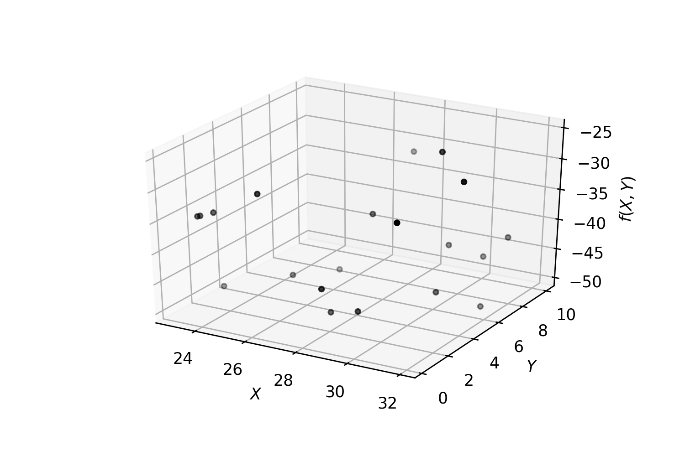
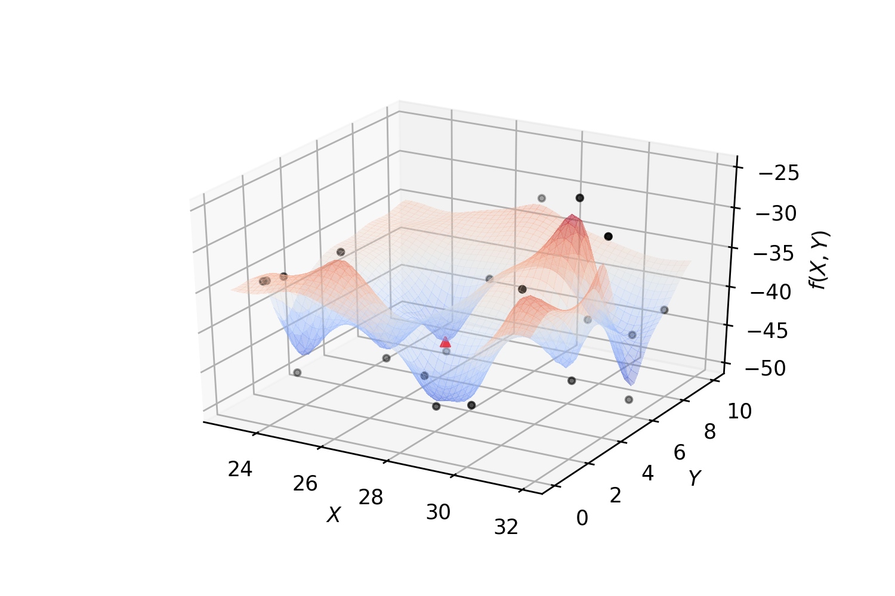

===================================
Surrogate-Based Optimization
===================================
Surrogate-based optimization represents a class of optimization methodologies that make
use of surrogate modeling techniques to quickly find the local or global optima.
It provides us a novel optimization framework in which the conventional optimization algorithms,
e.g. gradient-based or evolutionary algorithms are used for sub-optimization.

For optimization problems, surrogate models can be regarded as approximation models for
the cost function and state function, which are built from sampled data obtained by
randomly probing the design space. Once the surrogate models are built, an optimization
algorithm can be used to search the new candidate, based on the surrogate models,
that is most likely to be the optimum. Since the prediction with a surrogate model is
generally much more efficient than that with a numerical analysis code, the
computational cost associated with the search based on the surrogate models is
generally negligible. Surrogate modeling is referred to as a technique that makes use
of the sampled data to build surrogate models, which are sufficient to predict the output
of an expensive function at untried points in the feasibility space. Thus, how to choose
sample points, how to build surrogate models, and how to evaluate the accuracy of surrogate
models are key issues for surrogate optimization.

Fit a regressor and find a (local) minimum:

The following algorithm summarizes implemented Surrogate-Based Optimization for an
expensive function :math:`f` that can only be evaluated `MaxIter` times with a minimum
`MinEvals` random evaluations.

.. note::
    set :math:`E=\emptyset`, :math:`NumIter=0`

    while :math:`NumIter<MaxIter` do

        sample a random point :math:`x_0` from feasible space

        if :math:`\#(E) < MinEvals` then
            update :math:`E=E\cup\{(x_0, f(x_0))\}`

        else
            find a surrogate :math:`\hat{f}` that fits the points in :math:`E`

            find the minimum :math:`x_*` of :math:`\hat{f}` using :math:`x_0` as the initial point (if required)

            evaluate :math:`f` at :math:`x_*` and update :math:`E=E\cup\{(x_*, f(x_*))\}`

        update :math:`NumIter = NumIter+1`

    return the pair :math:`(x, y)\in E` with lowest found value for :math:`y` as the approximation for the minimum of :math:`f`

Clearly, there are various methods to accomplish some of the steps in the above algorithm like
how to sample a new point :math:`x_0`, how to find the surrogate :math:`\hat{f}`, how to minimize
and how to decide when we wish to use the surrogate.

Scoring direction
===================================
The search minimizes, so a trial score is stored as a **loss**: every value is
negated once before it reaches :math:`f`, the surrogate and `scipy.optimize.minimize`.
That is sound only for a higher-is-better score, which is scikit-learn's own
convention:

.. list-table::
   :header-rows: 1

   * - ``scoring``
     - scorer value
     - stored ``loss`` (minimized)
   * - ``"accuracy"``, ``"roc_auc"``
     - :math:`+\text{accuracy}`
     - :math:`-\text{accuracy}`
   * - ``"neg_root_mean_squared_error"``
     - :math:`-\text{RMSE}`
     - :math:`+\text{RMSE}`
   * - ``make_scorer(mean_absolute_error, greater_is_better=False)``
     - :math:`-\text{MAE}`
     - :math:`+\text{MAE}`
   * - ``None`` (estimator's ``score``)
     - :math:`R^2` / accuracy
     - negated

Consequently ``best_estimator_score`` is a loss (lower is better), while
``best_score_`` and ``cv_results_["mean_test_score"]`` are reported back in the
scorer's own units (higher is better), matching ``GridSearchCV``.

``AML`` mirrors the same split: ``AML.best_estimator_score`` is the minimized
loss and ``AML.best_score_`` is the higher-is-better value. Both of
``AML.optimize_pipeline``'s branches return a loss — the surrogate branch returns
``SurrogateRandomCV.best_estimator_score``, and the no-config branch (a candidate
with no tunable parameters, scored by a plain ``cross_val_score``) negates its
mean so the two rank identically in ``get_top`` and the EOA fitness.

A *bare* callable is refused with a ``TypeError``: ``check_scoring`` passes it
through unchanged, so a plain lower-is-better function such as
``lambda est, X, y: mean_absolute_error(y, est.predict(X))`` would be negated into
:math:`-\text{MAE}` and the search would maximize the error. Wrap it explicitly::

    from sklearn.metrics import make_scorer, mean_absolute_error

    scoring = make_scorer(mean_absolute_error, greater_is_better=False)

Sampling
===================================
Three different sampling methods have been implemented and the `SurrogateSearch` class accepts
user defined sampling classes that have a certain signature.

CompactSample
---------------------------
This class samples a random point from the feasibility set.

BoxSample
---------------------------
This class samples a random point from a cube centered around a given point (usually
the last point :math:`f` was evaluated on) with a given length. It makes sure that the sample
belongs to the feasibility set.

The length of the edges of the cube can be provided by setting `init_radius` (default: 2.)

A contraction ratio can be provided by setting `contraction` (should be bigger than 0 and
less than 1) to shrink the volume of the cube to assure fast convergence to a (local) optima
(default value: 0.9).

SphereSample
---------------------------
This class samples a random point from a sphere centered around a given point (usually
the last point :math:`f` was evaluated on) with a given radius. It makes sure that the sample
belongs to the feasibility set.

The radius of the sphere can be provided by setting `init_radius` (default: 2.)

A contraction ratio can be provided by setting `contraction` (should be bigger than 0 and
less than 1) to shrink the radius of the sphere to assure fast convergence to a (local) optima
(default value: 0.9).

.. note::
    The sampling method can be passed to an instance of `SurrogateSearch` via `sampling` parameter.
    Along with `sampling` class, `radius`, `contraction`, `ineq`, and `bounds` may be provided to
    be used by the sampling class. `ineq` is a list of callables which represent the constraints.
    `bounds` is a list of tuples of real numbers representing the bounds on each variable.

.. tip::
    A user-defined sampling class should follow the following  structure::

        class UserSample(object):
            def __init__(self, **kwargs):
                pass

            def check_constraints(self, point):
                """
                Checks constraints on the sample if provided;
                `point` is the candidate to be checked;
                should return a `boolean` True or False for if all constraints hold or not.
                """
                pass

            def sample(self, centre, cntrctn=1.):
                """
                Samples a point out of an sphere centered at `centre`;

                `centre` is a `numpy.array` the center of the sphere;
                `cntrctn` is a  `float` customized contraction factor
                returns a `numpy.array` the new sample
                """
                pass

Surrogate models
===================================
`SurrogateRandomCV` uses scikit-learn's RBF
`GaussianProcessRegressor` by default. This default is based on the equal-budget
benchmark comparison documented in ``benchmarks/DESIGN.md``; pass a
scikit-learn-style regressor with ``regressor=...`` to select another response
surface. `SurrogateSearch` accepts regressors that implement ``fit`` and
``predict`` and return one finite prediction for each query point.

After fitting, ``SurrogateRandomCV.surrogate_info_`` reports the resolved
regressor's fully qualified class name, whether it came from the default or
was supplied by the caller, the effective minimum number of points before
surrogate fitting, and fit/optimization counts. ``fit_history`` records each
attempt's iteration, training-point count, fit status, and local-optimizer
status. The same information is available at ``summary_["surrogate"]`` and
from ``SurrogateSearch.surrogate_info_``.

There is no automatic replacement surrogate or random-search fallback when
surrogate fitting or prediction raises an exception: the exception is
propagated, and its stage and type remain in ``fit_history``. A non-successful
SciPy local-optimization result is recorded and counted; that iteration does
not evaluate a candidate, and the search loop continues unless another
termination condition is met. These diagnostics distinguish response-surface
failures from candidate-model CV failures, which are handled by
``error_score`` and reported in ``failure_summary_``.

.. note:: The surrogate is *not* a search strategy. It tunes the hyperparameters
    of every candidate pipeline the search produces, regardless of how those
    pipelines are chosen. How pipelines are chosen is the search strategy —
    evolutionary (``AML.fit(strategy="eoa")``) or exhaustive enumeration of the
    pipeline space (``AML.fit(strategy="exhaustive")``, see :doc:`eoa`).

Selectable surrogate families for pipeline search
=================================================
``AML`` optimizes every pipeline it searches with a *single* surrogate regressor
chosen per experiment. ``SKSurrogate.build_surrogate`` builds it from four
options — an estimator (``gpr``, ``krr`` or ``svr``), an iteration budget
(``itrs``, default 30), a sampling strategy (``sampling``, default
``BoxSample``; ``CompactSample`` and ``SphereSample`` also available) and a
SciPy solver (default ``L-BFGS-B``). The regressor's own hyperparameters are
tuned by an inner randomized cross-validated search over its kernel grid::

    from SKSurrogate import build_surrogate, AML

    surrogates = build_surrogate("krr", itrs=30, sampling="CompactSample")
    aml = AML(config=..., surrogates=surrogates, min_random_evals=10)

The same family powers the Experiments page, whose advanced mode exposes the
estimator as a dropdown plus ``itrs``, ``sampling`` and ``min_random_evals``
(default 10 random initial points before the surrogate is exploited).
``build_surrogate`` is the single source of truth for the estimator grids, and
``AML``'s implicit default when no surrogate is supplied is a single
Gaussian-process surrogate via ``build_surrogate("gpr", 30, "BoxSample")``.

Optimizer
===================================
A `scipy` optimizer can be used to find a minimum of the surrogate at each iteration.
The local subproblem carries inequality constraints whenever the search has any —
either user ``ineqs`` or the trust region added by ``search_sphere=True`` — and only
four SciPy methods honour them: ``COBYLA``, ``SLSQP``, ``trust-constr`` and
``COBYQA``. Passing constraints to any other method is a **silent** correctness bug:
``scipy.optimize.minimize`` accepts the ``constraints`` argument, warns, ignores it,
and returns a point that need not be feasible. ``SurrogateSearch`` and
``SurrogateRandomCV`` therefore raise ``ValueError`` at configuration time when a
bounds-only method (``L-BFGS-B``, ``TNC``, ``BFGS``, ``Powell``, …) is combined with
constraints; the same method is accepted when the search has no constraints at all.
``build_surrogate``'s ``L-BFGS-B`` default is the unconstrained case.

An alternative for the scipy optimizer is 'Optimithon'.

===================================
Hyperparameter Optimization
===================================
Hyperparameter Optimization in machine learning with respect to a given performance measure
(e.g., accuracy, f1, auc, ...) usually is a computationally expensive task which fits within
the scope of surrogate optimization technique. In fact this is the main reason that the project
exists. Therefore, there is a special class designed for hyperparameter optimization of machine
learning methods that follow the schema of the very popular machine learning library `scikit-learn`.
The class `structsearch.SurrogateRandomCV` is a substitute for scikit-learn's `GridSearchCV` or
`RandomizedSearchCV`. An isntance of `SurrogateRandomCV` takes an estimator like `GridSearchCV` and
`RandomizedSearchCV` and a `params` parameter, like `param_grid` or `param_distributions`,
which determines (ranges of) the values each argument of the estimator can take over.
The difference is that not only it accepts discrete list of values for each parameter, it also
accepts ranges of integers and real numbers too. The `params` is a dictionary whose keys are
the estimator's arguments and their values are objects of the followin types:

    + `Real(a, b)`: an interval of real numbers between :math:`a` and :math:`b`;
    + `Integer(a, b)`: an interval of integer numbers between :math:`a` and :math:`b`;
    + `Categorical(list)`: a list consists of discrete values;
    + `HDReal(a, b)`: An `n` dimensional box of real numbers corresponding to the classification groups (e.g. `class_weight`). `a` is the tuple of lower bounds and `b` is the tuple of upper bounds.

**Example** The following code searches for the best values for a `SVC`::

    from sklearn.svm import SVC
    from SKSurrogate import *
    clf = SVC()
    params = {'C': Real(1.e-5, 10),
              'kernel': Categorical(['poly', 'rbf']),
              'degree': Integer(1, 4),
              'gamma': Real(1.e-5, 10),
              'class_weight': HDReal((1.e-3, 1.e-3), (10., 10.))}
    srch = SurrogateRandomCV(clf, params)
    srch.fit(X, y)
    print(srch.best_estimator_)

The scikit-learn spellings ``param_distributions`` and ``n_iter`` are accepted
alongside ``params`` and ``max_iter`` (give one spelling of each), and spaces may be
written as shorthand: a ``(a, b)`` tuple is an ``Integer`` when both ends are integers
and a ``Real`` otherwise, and any other list is a ``Categorical``. ``sampling`` accepts
``"box"``, ``"sphere"`` or ``"compact"``, and the fitted search exposes ``best_params_``.
The previous example then reads::

    srch = SurrogateRandomCV(SVC(), param_distributions={
        'C': (1.e-5, 10), 'kernel': ['poly', 'rbf'], 'degree': (1, 4)}, n_iter=30)

``SurrogateRandomCV`` also supports ``groups`` in ``fit`` for group-aware
cross-validation, ``time_limit`` and ``max_evals`` resource budgets, and
``random_state`` for reproducible sampling. Evaluated configurations are
available through ``evaluation_history_`` and ``cv_results_``; each record
includes parameters, score, status, duration, and any captured error. Use
``pareto_frontier()`` to inspect completed trials that trade validation score
against evaluation duration.

Use ``continue_`` to resume from a previous search checkpoint. The legacy
``Continue`` spelling remains accepted; if a non-default ``Continue`` value
conflicts with ``continue_``, construction raises ``ValueError``. No removal
release is scheduled for the legacy spelling.

Search-space and pipeline safeguards include:

* conditional parameters, which are omitted when their activation rule does not match;
* forbidden parameter mappings or callables, recorded as ``invalid`` trials before fitting;
* logarithmic ``Real`` and ``Integer`` ranges using ``scale="log"``;
* pre-fit validation of unknown estimator parameters, bounds, categorical domains, and
    representative estimator configuration;
* static pipeline validation for step names, duplicate steps, transformer capabilities,
    and final estimator capabilities;
* candidate preflight that rejects preprocessing failures and transformations that produce
    zero features before an estimator is fitted.

Fit failures are retained per fold with their exception type, message, traceback,
parameters, and fold index. ``failure_summary_`` reports failure rates and failure types
by estimator. Trial statuses distinguish ``invalid``, ``failed``, ``pruned``, and
``complete`` evaluations.

For an estimator with no tunable parameters, pass an empty ``params`` mapping.
The search evaluates that estimator directly with cross-validation instead of
building a zero-dimensional surrogate problem.

Progress output goes through the standard library ``logging`` module
(``SKSurrogate`` loggers, no change to default console output), and a search can
report every trial to a callback and export a JSON audit bundle. The record
contracts — logger names and levels, the ``fit_score`` and sampling-source
telemetry, the ``callbacks`` event schema, and ``to_audit_dict()`` — are
documented in :doc:`telemetry`.

.. note::
    It is worth mentioning that using a Gaussian Process Regression as the regressor simulates
    a particular variation of the optimization method known as Bayesian Optimization method.

    Bayesian Optimization is the method employed by the popular package
    `skopt <https://scikit-optimize.github.io/>`_. The ui implemented for ``SurrogateRandomCV``
    is very much similar to the one of ``skopt.BayesSearchCV``, so one could use the same code
    for both given that the imports are carefully done.

.. tip::
    The class ``SurrogateRandomCV`` works with intervals to handel the hyperparameters and
    the current sampling classes do not impose extra constraints on ``SurrogateSearch`` other
    than ranges for parameters, alternative `scipy.minimize` solvers can be used as well, such
    as `L-BFGS-B` and `TNC`. Those two are bounds-only, so they are refused as soon as the
    search carries inequality constraints (``ineqs`` or ``search_sphere=True``); use `SLSQP`,
    `COBYLA`, `trust-constr` or `COBYQA` there.