=====================================================
Walkthrough: from CSV to monitored model (diabetes)
=====================================================

This tutorial follows one small regression problem through the whole web UI
and shows, at every step, what the UI sends to the REST API and how to do the
same thing from Python. Read it with the UI open, or read just the
"REST" and "Python" blocks to script the workflow.

**The problem.** scikit-learn's diabetes data: ten baseline measurements
(``age``, ``sex``, ``bmi``, ``bp``, ``s1`` to ``s6``) for each patient, and a
numeric ``progression`` score one year later. We want a model that predicts
``progression`` and a trail that lets us trust and operate it.

.. contents:: Steps
   :local:
   :depth: 1

Setup
=====

Download the two CSV files (a shuffled 75/25 split of the 442 patients):

* :download:`walkthrough-diabetes-train.csv` (332 rows)
* :download:`walkthrough-diabetes-validation.csv` (110 rows)

Start the control plane with Docker (from a source checkout)::

    docker compose --profile prod up --build -d   # UI + API on http://localhost:8013

For development with hot reload use ``docker compose --profile dev up``
instead; the UI is then on http://localhost:5174. See :doc:`controlplane` for
configuration (API keys, CORS, storage). Open the UI in a browser; the
"API online" indicator in the top bar must be green.

.. note::
   The examples below use the task name ``diabetes`` and ``$API`` for the API
   base URL, e.g. ``API=http://localhost:8013/api``. A *task* is a workspace
   that owns its datasets, bundles, registry and logs; pick or create one with
   the **Task** selector at the top of every page.

Every screen of the UI is a thin layer over the REST API, which in turn calls
the ``SKSurrogate`` library. The sidebar is ordered like the workflow:
**1. Data → 2. Model → 3. Release → 4. Operate**.

1. Dashboard
============

Select (or type) the task ``diabetes``. The Dashboard shows a "getting started"
card with the next suggested step and the counts of datasets, bundles and jobs.

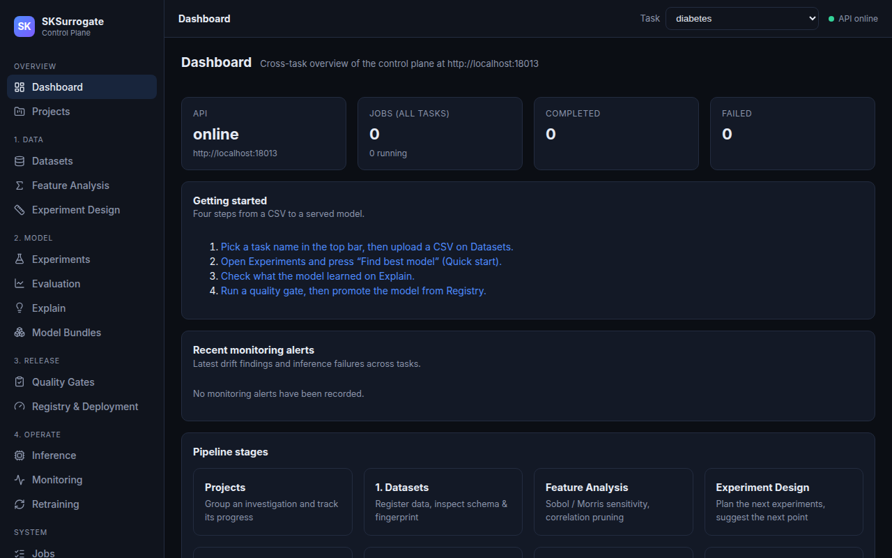

   The Dashboard after the walkthrough is complete.

2. Datasets: register your data
===============================

Open **Datasets**.

1. Choose the training CSV and click **Inspect CSV**. The UI shows the number of
   rows, the detected column types and a preview before anything is stored.
2. Set the **target** to ``progression`` and the **partition** to ``train``.
3. Review the column types. ``sex`` is detected as binary but its values are
   standardised floats, so set it to ``float64`` in the *Type for sex*
   control (otherwise it would be treated as a category).
4. Click **Commit dataset**. Repeat with the validation CSV and the partition
   ``validation``.

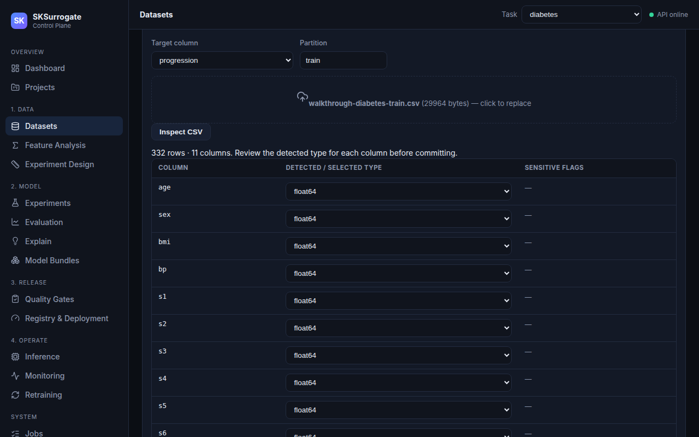

   Inspect before you register: row count, detected types and preview.

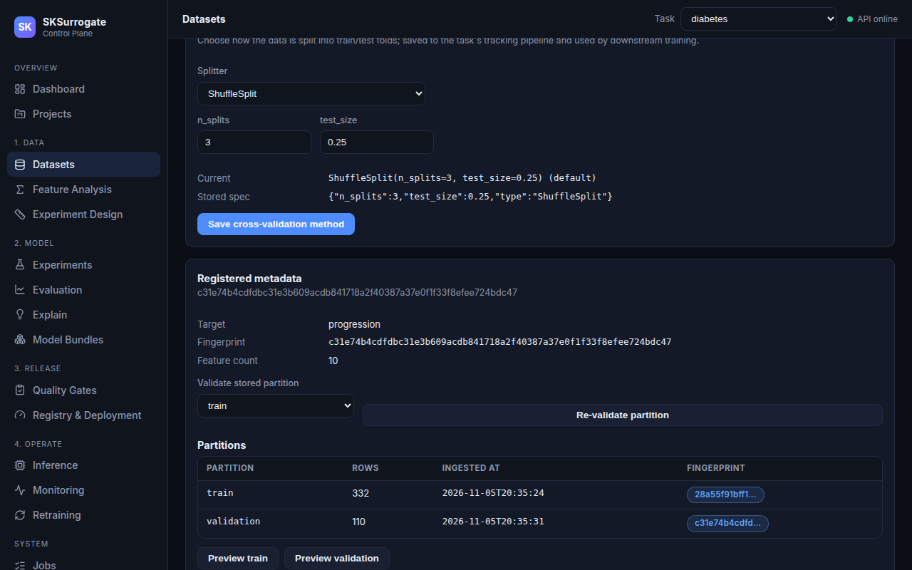

   Both partitions registered. The fingerprint identifies the exact data; it
   follows the model through every later step (the "lineage rail").

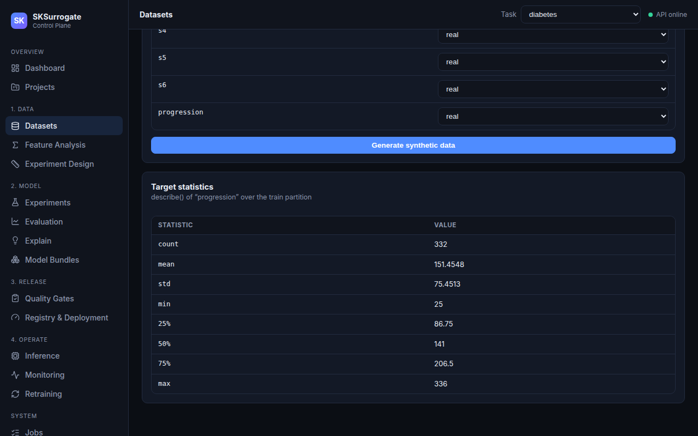

   Target statistics (``describe()`` of ``progression``) and the other
   helpers on the page: schema validation of new data and synthetic data
   generation.

**Behind the scenes.** Registering stores the rows in the task's ``mltrack``
database, together with the schema (column types) and a fingerprint of the
data. Partitions are named; later steps refer to them by name.

REST::

    curl -X POST $API/datasets/diabetes/inspect  -F file=@walkthrough-diabetes-train.csv
    curl -X POST $API/datasets/diabetes/register \
         -F file=@walkthrough-diabetes-train.csv      -F target=progression -F partition=train
    curl -X POST $API/datasets/diabetes/register \
         -F file=@walkthrough-diabetes-validation.csv -F target=progression -F partition=validation
    curl $API/datasets/diabetes                          # list partitions

Python::

    import pandas as pd
    from SKSurrogate.mltrace import mltrack

    track = mltrack("diabetes")
    track.register_data(pd.read_csv("walkthrough-diabetes-train.csv"),
                        target="progression", partition="train")

The **Validate** panel (``POST /api/datasets/diabetes/validate``,
``mltrack.validate_data``) checks a new file against the registered schema, for
example before scoring it.

3. Feature Analysis: what matters?
==================================

Open **Feature Analysis** (data-driven feature screening).

1. Pick a method (here *Sobol*) and click **Run sensitivity analysis**. It runs as a
   job and takes a few seconds.
2. The heatmap ranks features by the chosen method.
3. Set the **correlation threshold** to 0.7 and click **Run correlation threshold** to drop highly correlated features.
   Here ``s1`` and ``s3`` are dropped and 8 features are kept.

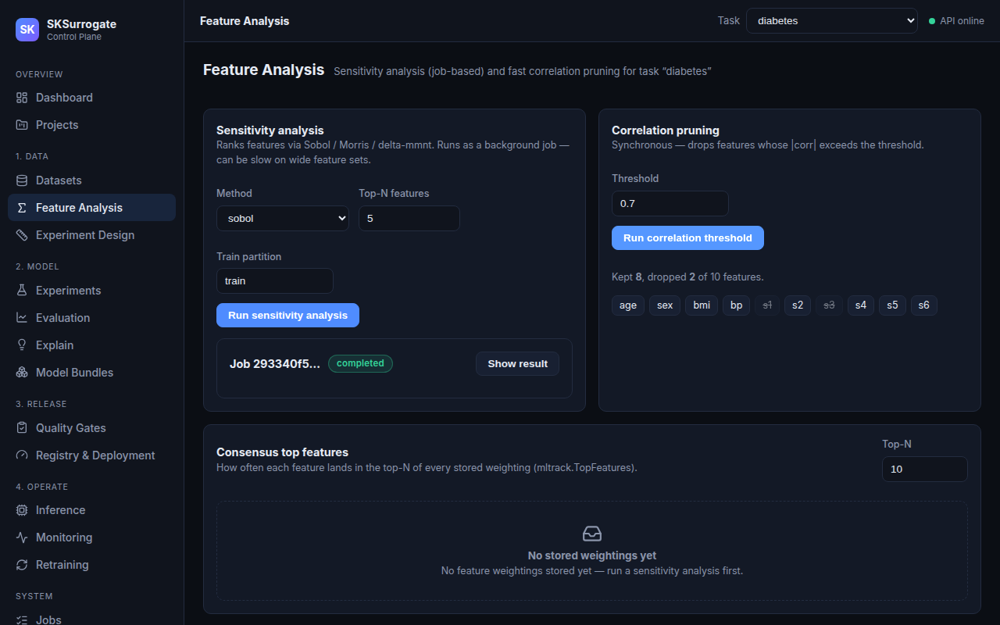

   Run the analysis; progress is shown while the job runs.

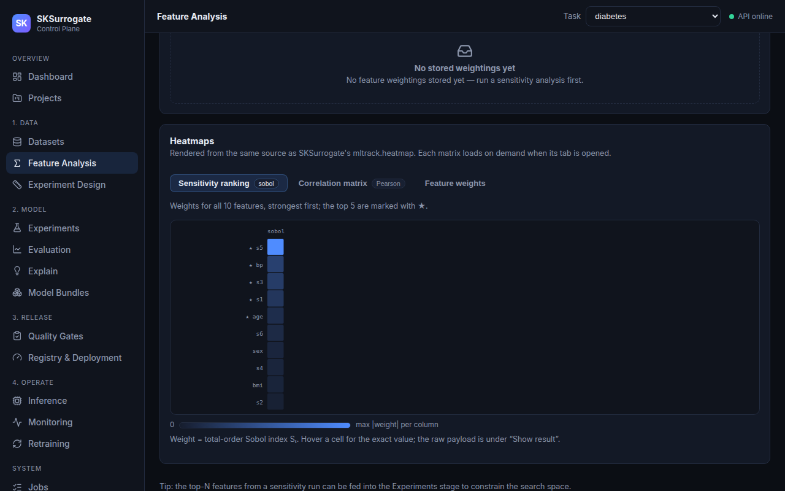

   Ranking and correlation filtering.

.. warning::
   Sensitivity rankings are *exploratory* and depend on the method. On this
   data Sobol ranks ``bmi`` low, although it is the strongest predictor in the
   fitted model (see step 7). Treat this screen as a screening aid and
   confirm with the model-based importance in **Explain**. Results of a run are
   kept in the page session: re-run after a reload.

REST::

    curl -X POST $API/sensitivity/diabetes/run -H 'content-type: application/json' \
         -d '{"method":"sobol","train_partition":"train"}'      # returns a job id
    curl $API/jobs/<job_id>                                     # poll for the result
    curl -X POST "$API/sensitivity/diabetes/correlation-threshold?threshold=0.7"        # synchronous

Python: ``SKSurrogate.sensapprx.SensAprx`` and ``CorrelationThreshold`` (see :doc:`sensitivity`).

4. Experiments: find a model
============================

Open **Experiments → Quick start**:

1. **Problem type**: *Regression*. The preset picks sensible scikit-learn
   models and the scoring (negative RMSE).
2. **Budget**: *Balanced*. *Fast* is a smoke test, *Thorough* searches longer.
3. Click **Find best model**. A job starts; the page shows its progress and,
   when done, the best pipeline and score.

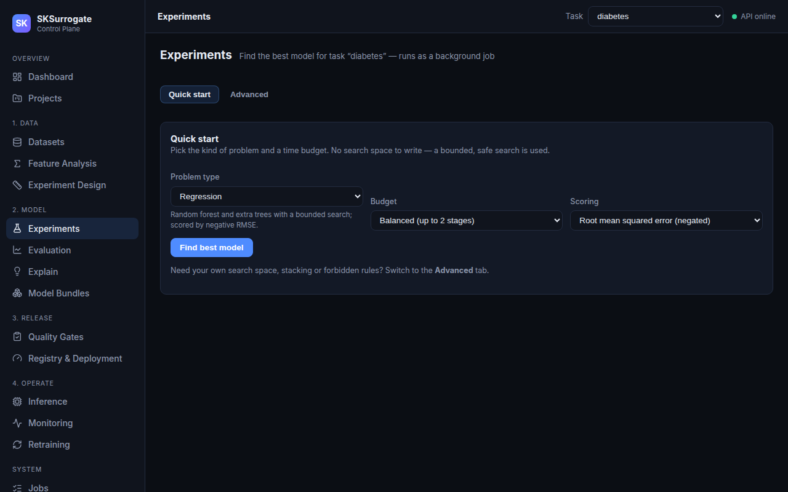

   Quick start: two choices and one button.

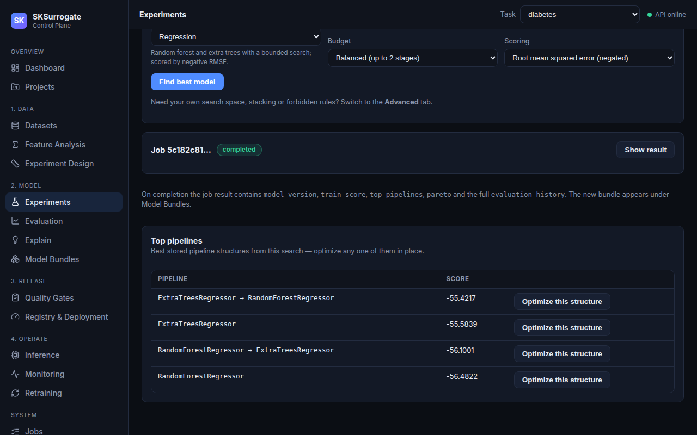

   About 30 seconds later: the best pipeline (ExtraTrees followed by a
   RandomForest, RMSE ≈ 55) and the model bundle it produced.

The **Advanced** tab exposes everything else: a custom search space, the
search strategy (``eoa`` evolutionary or ``surrogate``), forbidden
combinations, generations, Dask backend and resumable runs. Quick start only
fills in a preset for you; both tabs call the same endpoint.

**Behind the scenes.** The experiment runs the library's ``AML`` search on the
``train`` partition, then saves the winning fitted pipeline as a *model
bundle*: the estimator plus its schema, metrics, dataset fingerprint,
dependency versions and an audit trail.

REST::

    curl -X POST $API/experiments/diabetes/run -H 'content-type: application/json' \
         -d '{"preset":"regression","strategy":"eoa","length":2,
              "max_generations":3,"scoring":"neg_root_mean_squared_error"}'
    curl $API/jobs/<job_id>            # status, then the result

Python::

    from SKSurrogate.aml import AML

    aml = AML(preset="regression", length=2, scoring="neg_root_mean_squared_error")
    aml.fit(X, y, strategy="eoa", max_generations=3, num_parents=4)
    best = aml.best_estimator_

5. Model Bundles: baseline and inspection
=========================================

Open **Model Bundles**. Training a simple *baseline* gives the search result
something to beat: choose ``linear_regression``, train partition ``train``,
validation partition ``validation`` and click **Train baseline**.

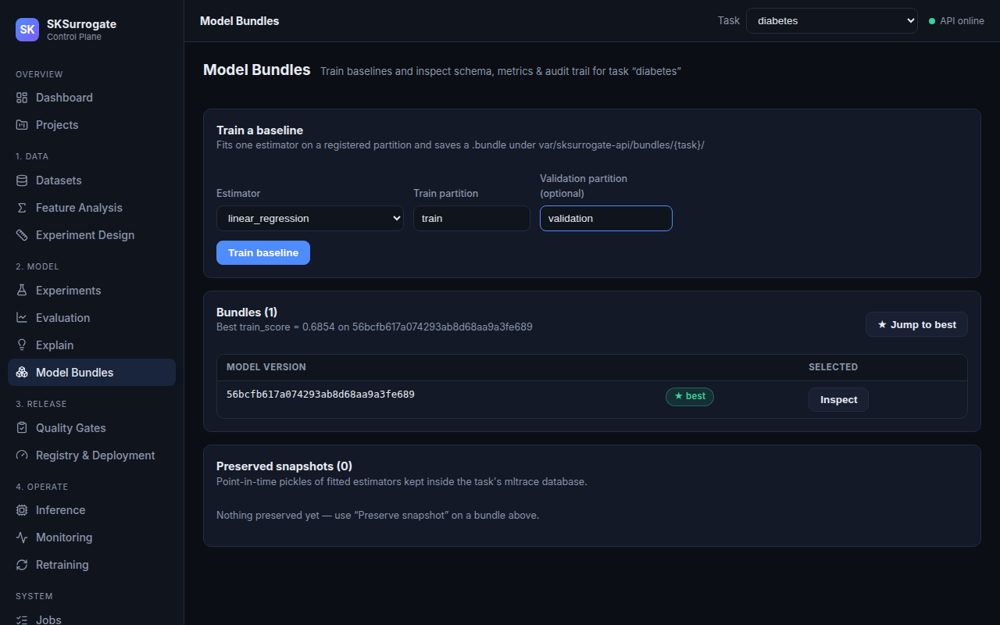

   Train a baseline; every bundle appears in the list ("★ best" marks the
   best recorded score).

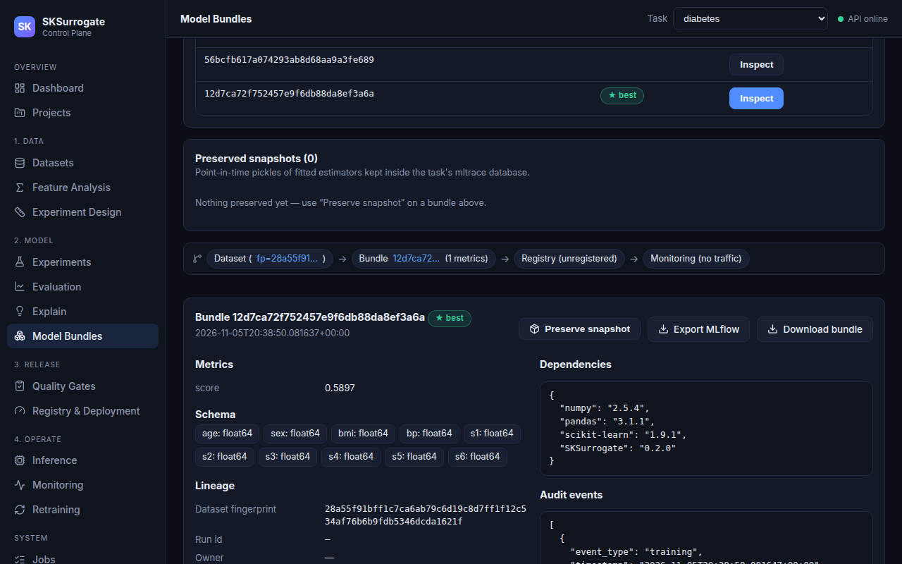

   Inspect a bundle: metrics, schema, dependency versions, audit events and
   the lineage rail (dataset → bundle → registry → monitoring).

.. note::
   The experiment bundle records ``train_score`` (a score on the data it was
   fitted to) while the baseline records ``score`` (on the validation
   partition), so the two numbers are not directly comparable. Use
   **Evaluation** for a like-for-like comparison.

REST::

    curl -X POST $API/bundles/diabetes/train-baseline -H 'content-type: application/json' \
         -d '{"estimator":"linear_regression","validation_partition":"validation"}'
    curl $API/bundles/diabetes            # list
    curl $API/bundles/diabetes/best

Python: bundles are ``SKSurrogate.modelbundle.ModelBundle`` objects
(``save_bundle`` / ``load_bundle``); see :doc:`modelbundles`.

6. Evaluation: compare models
=============================

**Evaluation** compares stored bundles: an overview of recorded metrics and
one tab per metric (here R², RMSE, MAE, pinball loss, explained variance)
plotting learning curves — held-out score (solid) versus training score
(dashed) as the training size grows.

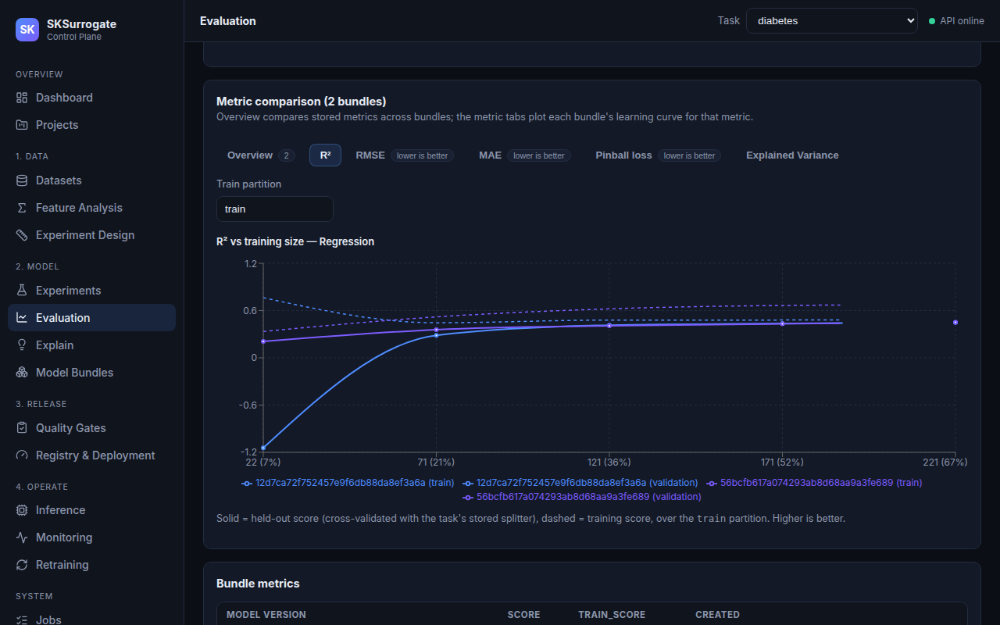

   Both models converge to a similar held-out R² (about 0.4 to 0.45) with
   the full training data. The small gap between solid and dashed lines
   means neither is badly overfitting.

Diagnostic curves (ROC / PR) are shown for classification bundles only; for a
regression task the card says so.

REST::

    curl $API/evaluation/diabetes/metrics
    curl "$API/evaluation/diabetes/learning-curves?scoring=r2"
    curl -X POST $API/evaluation/diabetes/nested-cv -H 'content-type: application/json' \
         -d '{"model_version":"<version>"}'          # expensive: runs as a job

7. Explain: why does it predict that?
=====================================

Open **Explain**, choose the model version and click **Explain model**.

* The bar chart is *permutation importance*: how much the score drops when a
  feature is shuffled. ``bmi``, ``s5`` and ``bp`` dominate.
* The small curves are *partial dependence* for the top features: how the
  prediction moves across each feature's range (here it rises with ``bmi``,
  ``s5`` and ``bp``). Choose 3 or 5 reference samples to add dashed mean ±
  sample-SD lines across distinct subsets; they describe reference-sample
  sensitivity, not a confidence band.
* The **Accumulated local effects** card computes ALE instead of marginal
  averages: each feature moves between adjacent observed quantile bins and the
  local response differences are accumulated, which avoids averaging over
  feature combinations that never co-occur. Categorical features are skipped,
  and ALE is still a model description rather than a causal effect.
* The **Row-level explanation** card explains a single stored row against a
  baseline (reference mean or an explicit row). Contributions telescope exactly
  to the prediction change; the spread across 5 or 10 feature orders shows how
  much the split depends on order (interactions and correlated features).

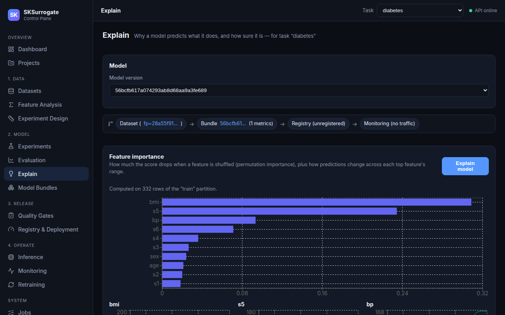

   Permutation importance (top) and partial dependence for the top features.

Under **Prediction intervals** choose a coverage (80 / 90 / 95 %) and click
**Compute intervals**. The UI reports the half-width of a split-conformal
interval, observed coverage with a Wilson interval, mean interval width and
score, and how many held-out rows were evaluated. The diagnostic confidence
interval is descriptive and is distinct from the marginal split-conformal
coverage claim. Intervals are available for regression bundles only.

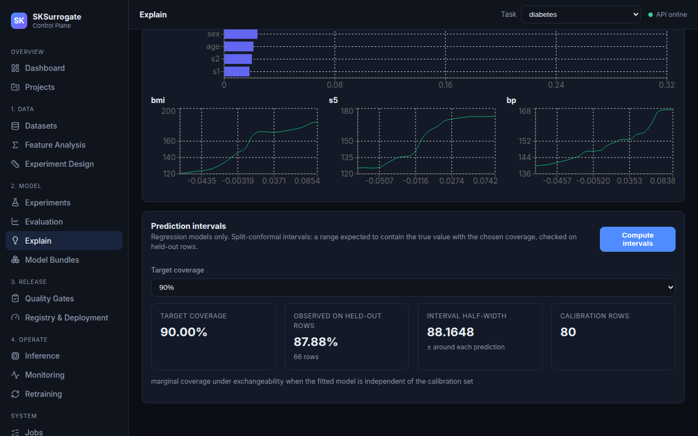

   "Prediction ± 88" is a 90 % interval on this model.

REST::

    curl -X POST $API/evaluation/diabetes/<version>/explain \
         -H 'content-type: application/json' \
         -d '{"partition":"train","stability_samples":3}'
    curl -X POST $API/evaluation/diabetes/<version>/ale \
         -H 'content-type: application/json' \
         -d '{"partition":"train","features":["bmi","bp"],"n_bins":20}'
    curl -X POST $API/evaluation/diabetes/<version>/explain/row \
         -H 'content-type: application/json' \
         -d '{"row_index":12,"orders":5,"baseline":"reference_mean"}'
    curl -X POST $API/evaluation/diabetes/<version>/intervals \
         -H 'content-type: application/json' -d '{"alpha":0.1}'

Python: ``sklearn.inspection.permutation_importance`` and
``partial_dependence``, and
``SKSurrogate.mltrace.split_conformal_regression_interval(estimator, X_train,
y_train, X_calibration, y_calibration, X_test, alpha=0.1)``.

8. Quality Gates: may this model ship?
======================================

Open **Quality Gates**, choose the bundle, click a metric chip (``train_score``)
to add a minimum threshold (≥ 0.5) and click **Run quality gate**. The result
lists each check: the bundle's schema is compatible, and every metric reaches
its threshold. An optional maximum bundle size is checked as well.

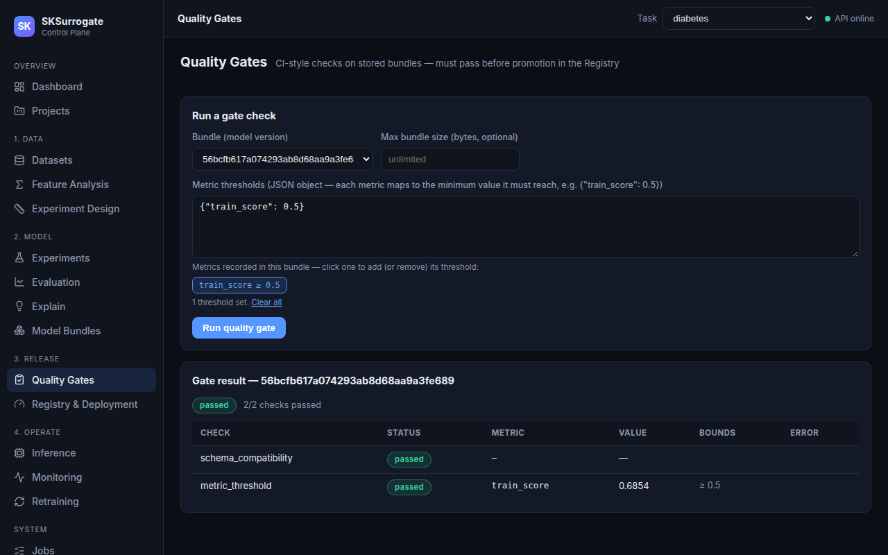

   2 of 2 checks passed.

REST::

    curl -X POST $API/quality-gates/diabetes/<version>/check \
         -H 'content-type: application/json' \
         -d '{"metric_thresholds":{"train_score":0.5}}'

Python::

    from SKSurrogate.ci import check_bundle_quality
    report = check_bundle_quality(bundle, metric_thresholds={"train_score": 0.5})

9. Registry & Deployment: approve and promote
=============================================

Open **Registry & Deployment**.

1. **Register** the bundle: it enters the registry as a *candidate*.
2. **Promote** it along ``validated → staging → production``. Each step reruns
   the default bundle check, which verifies that it can be loaded but does not
   apply the custom metric thresholds or bundle-size limit from the Quality
   Gates page. Enforce any required custom policy separately before promoting.
   Each step also needs *N* unique approver names (comma-separated, e.g.
   ``alice, bob`` with *Required approvals* = 2). Approver names are free text:
   when the server enforces authentication (:doc:`auth-and-sharing`) a caller
   needs at least ``editor`` on the task to promote, but the names themselves
   are not checked against accounts.
3. The lifecycle strip shows which version holds each alias, with a **Use in
   Inference** shortcut. **Rollback** re-points an alias at an earlier version.

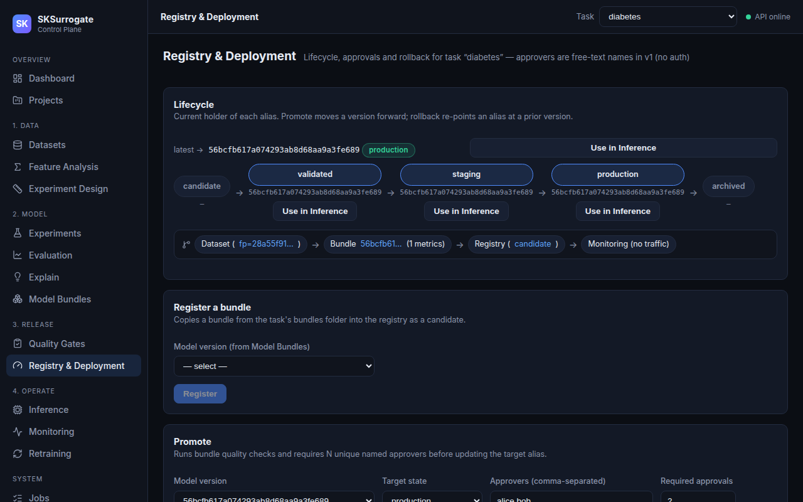

   The model has reached ``production``. Summary, history and audit log are
   below the forms.

REST::

    curl -X POST $API/registry/diabetes/register -H 'content-type: application/json' \
         -d '{"model_version":"<version>"}'
    curl -X POST $API/registry/diabetes/promote -H 'content-type: application/json' \
         -d '{"model_version":"<version>","state":"validated",
              "approvers":["alice","bob"],"required_approvals":2}'
    curl $API/registry/diabetes/summary   # also /history and /audit

Python::

    from SKSurrogate.modelbundle import ModelRegistry
    from SKSurrogate.deployment import DeploymentApprovalGate

    registry = ModelRegistry("registry/")
    registry.register(bundle)
    gate = DeploymentApprovalGate(registry, required_approvals=2)
    gate.promote("diabetes", bundle.model_version, "validated",
                 approvers=["alice", "bob"], quality_report=report)

10. Inference: get predictions
==============================

Open **Inference**. Resolve the model by *version* or by *registry alias*
(for example ``production``), then choose the input: a stored partition (the
target column is ignored) or inline JSON rows. Tick **Validate before run**
to reject input that does not match the bundle's schema. **Run prediction**
returns the predictions, latency and the request id; **Batch run** writes a CSV
under the task's predictions folder.

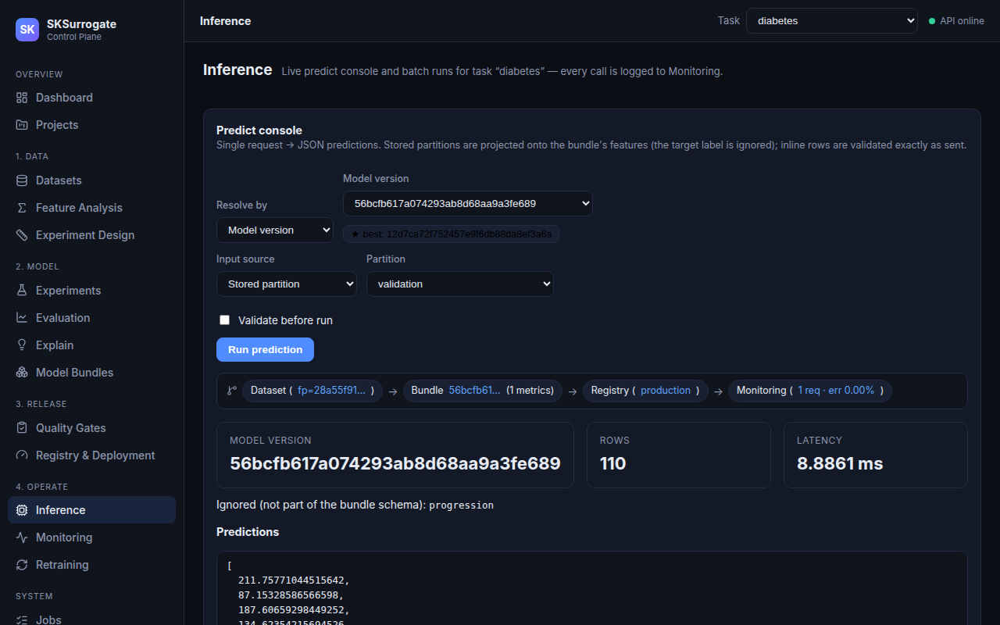

   110 predictions in about 9 ms. "Ignored: progression" confirms the target
   column was not used as an input.

REST::

    curl -X POST $API/inference/diabetes/predict -H 'content-type: application/json' \
         -d '{"alias":"production","partition":"validation"}'
    curl -X POST $API/inference/diabetes/predict -H 'content-type: application/json' \
         -d '{"alias":"production","rows":[{"age":0.03,"sex":0.05,"bmi":0.06,"bp":0.02,
              "s1":-0.04,"s2":-0.03,"s3":-0.02,"s4":-0.002,"s5":0.02,"s6":-0.02}]}'
    curl -X POST $API/inference/diabetes/predict-batch ...   # persists a CSV

Python::

    from SKSurrogate.inference import predict_batch
    production = registry.load("diabetes", alias="production")
    predictions = predict_batch(production, validation_frame)

11. Monitoring: keep watching
=============================

Every inference call is logged. **Monitoring** shows the serving summary
(requests, rows, error rate, latency), and checks for problems:

* **Drift check** compares a reference partition with a current one (here
  ``train`` against ``validation``) using PSI for numeric columns, plus
  categorical, range and missingness checks. ``s6`` exceeds the 0.2
  threshold; with only 110 rows that is a hint to look at, not proof.
* Further panels cover prediction drift, subgroup performance, sensitive
  attribute scans and fairness, and alert rules.

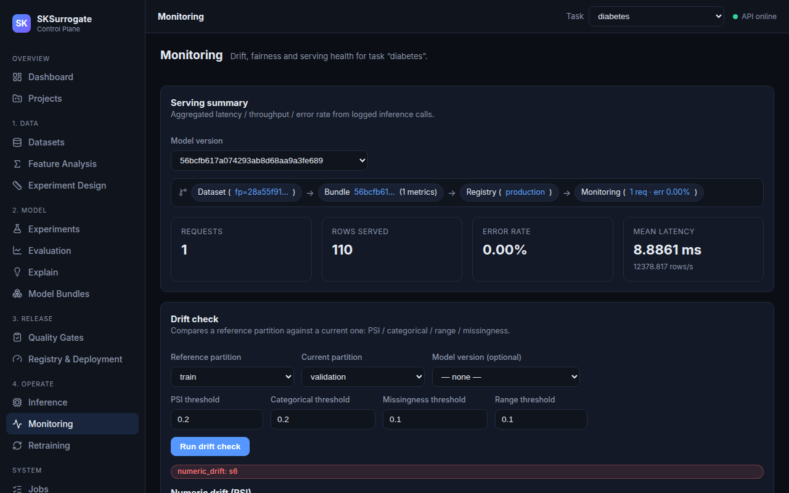

   Serving summary and the drift alert chip.

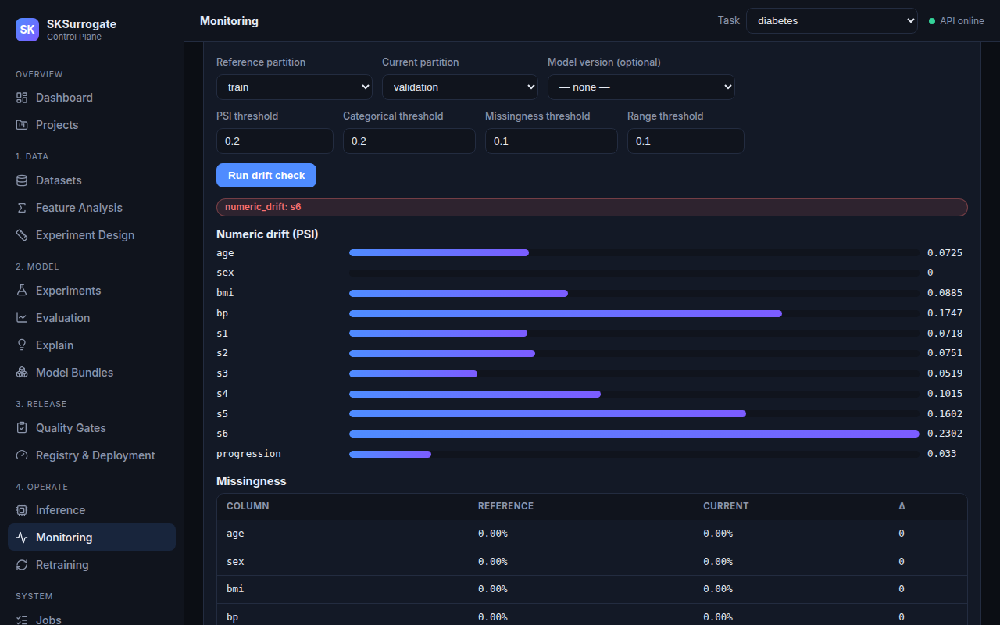

   PSI per column.

REST::

    curl "$API/monitoring/diabetes/<version>/summary"
    curl -X POST $API/monitoring/diabetes/drift -H 'content-type: application/json' \
         -d '{"reference_partition":"train","current_partition":"validation"}'

Python: ``SKSurrogate.monitoring`` (see :doc:`monitoring`).

12. Retraining and Jobs
=======================

**Retraining** re-runs the experiment when monitoring says the data has
drifted (``POST /api/retraining/diabetes/run`` or ``/trigger``; library:
``SKSurrogate.retraining``). **Jobs** lists every background run (sensitivity,
experiments, retraining) with status, result and, for experiments, a resume
option (``GET /api/jobs``).

13. Projects and Experiment Design
==================================

**Projects** groups the artifacts of one investigation (partitions, bundles and
jobs) with its research questions and notes, tracks how far along it is, and
shows the lineage rail of each linked bundle. Use **Link all from "diabetes"**
to attach everything in the task at once. Nothing is copied: a project only
holds references.

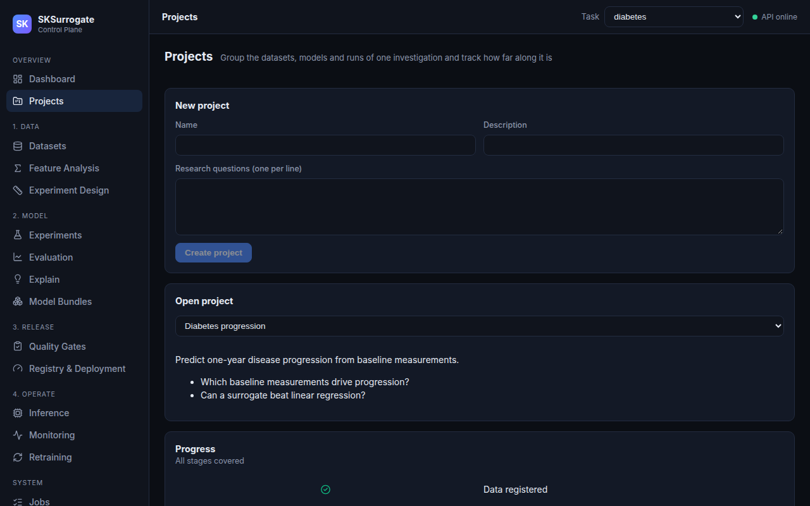

   A project with its questions; progress and linked artifacts are below.

REST: ``POST /api/projects`` (``name``, ``description``,
``research_questions``, ``artifacts``), ``GET /api/projects/{id}/summary``,
``POST /api/projects/{id}/notes``. Library: :doc:`research-projects`.

**Experiment Design** helps when you must *choose* experiments (for example
laboratory runs) rather than score existing data. List your continuous
variables with ranges, generate a space-filling Latin-hypercube plan, run the
experiments yourself, then paste the results to get the next suggested point.

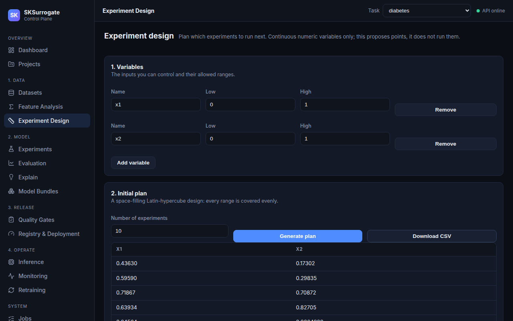

   A 10-point Latin-hypercube plan on two variables, downloadable as CSV.

REST: ``POST /api/design/latin-hypercube`` and ``POST /api/design/suggest-next``.
Library: ``SKSurrogate.design.latin_hypercube`` and ``suggest_next_point``
(see :doc:`experiment-design`).

14. Logs: investigate what a run did
====================================

Every background job records its own log. Open **Logs** in the sidebar and press
**Warnings & above** to hide routine progress, or toggle the individual severity
chips (each shows how many entries it currently holds). Click a job to follow it
live; clicking an entry opens its detail — the trial index, sampling phase and
status for per-trial telemetry, or the full traceback for a failure.

Two selectors narrow the view beyond a single job: **Dataset / task** restricts
entries to one dataset, and **Project** restricts them to the jobs linked as
evidence of that research project. Both are written to the URL
(``/logs?project=…&task=diabetes``), so a scoped investigation view can be
bookmarked or shared. Entries are captured per job as JSONL under the API home,
so they remain available after an API restart.

The same data is available over the API: ``GET /api/logs`` with ``level`` (a
minimum severity — ``WARNING`` returns WARNING, ERROR and CRITICAL),
``levels`` (an explicit subset), ``task_name``, ``project_id``, ``kind`` and
``q``; ``GET /api/logs/{job_id}`` to tail one job; and
``WS /api/logs/{job_id}/stream`` for incremental frames. In the library, the
same events are produced by ``SurrogateRandomCV(callbacks=[...])`` (forwarded
through ``AML(callbacks=...)``) and the finished run can be exported with
``to_audit_dict()``.

Everything in one Python script
===============================

The REST workflow above has a library equivalent that does not need the
server at all::

    import tempfile
    import pandas as pd
    from SKSurrogate.aml import AML
    from SKSurrogate.ci import check_bundle_quality
    from SKSurrogate.deployment import DeploymentApprovalGate
    from SKSurrogate.inference import predict_batch
    from SKSurrogate.modelbundle import ModelBundle, ModelRegistry

    train = pd.read_csv("walkthrough-diabetes-train.csv")
    valid = pd.read_csv("walkthrough-diabetes-validation.csv")
    X, y = train.drop(columns="progression"), train["progression"]

    aml = AML(preset="regression", length=2, scoring="neg_root_mean_squared_error")
    aml.fit(X, y, strategy="eoa", max_generations=3, num_parents=4)

    bundle = ModelBundle(aml.best_estimator_, task_name="diabetes",
                         schema={c: {"dtype": "float64"} for c in X.columns},
                         metrics={"train_score": aml.best_estimator_.score(X, y)})
    registry = ModelRegistry(tempfile.mkdtemp())
    registry.register(bundle)

    report = check_bundle_quality(bundle, metric_thresholds={"train_score": 0.5})
    DeploymentApprovalGate(registry, required_approvals=2).promote(
        "diabetes", bundle.model_version, "validated",
        approvers=["alice", "bob"], quality_report=report)

    model = registry.load("diabetes", alias="validated")
    print(predict_batch(model, valid.drop(columns="progression")).head())

Where to go next
================

* :doc:`ui-manual`: a screen-by-screen reference of the UI.
* :doc:`controlplane`: Docker, configuration, authentication and storage.
* :doc:`modelbundles`, :doc:`monitoring`, :doc:`sensitivity`: the library
  behind each step.
