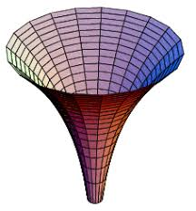

|CI| |Doc| |Licence|

|Logo|

SKSurrogate
==================
**Lightweight, maintained, scikit-learn-native surrogate tuner — a drop-in replacement for
``BayesSearchCV``.**

``SKSurrogate`` searches expensive objectives (hyperparameters, AutoML pipelines) with a
surrogate response surface built on ``scikit-learn``. The tuner is a ``BaseSearchCV``
subclass, so it plugs into existing scikit-learn code with the same ``fit``/``predict``
contract as ``GridSearchCV``, ``RandomizedSearchCV``, or ``BayesSearchCV`` — no new estimator
API, no framework lock-in.

Why not Optuna / vanilla BO?
----------------------------
- **Inequality constraints** (``ineq``): constrain the search region directly, rather than
  through penalty tricks or rejection sampling.
- **Trust-region contraction dynamics** (``contraction=0.9``): TuRBO/DYCORS-style radius
  contraction that keeps the search focused as it converges, scaling to medium- and
  high-dimensional spaces.
- **scikit-learn-native**: the tuner *is* a ``BaseSearchCV`` — it composes with pipelines,
  cross-validation, and the rest of the scikit-learn ecosystem.
- **Drift-aware** (see below): it records the identity of the data it optimized, so you can
  detect drift before inference.

The hybrid loop
---------------
Two cooperating search layers are the centerpiece of the package:

- **Evolutionary pipeline selector** (``EOA``): explores the space of transformers and
  estimators to assemble candidate pipelines.
- **Local surrogate tuner** (``SurrogateRandomCV``): fits a response surface to the best
  candidates and focuses evaluations where the surrogate predicts improvement.

This hybrid — global structure search plus local surrogate refinement — is what makes
``SKSurrogate`` a pipeline *designer* rather than just a hyperparameter tuner.

Since v0.2 the default response surface is a stock, un-tuned RBF Gaussian process (chosen over
the previous cubic Hilbert polynomial on the evidence of the equal-budget benchmark suite); a
custom regressor based on Hilbert Space techniques is still available (``HilbertRegressor``),
and all ``scikit-learn`` regressors are accepted for optimization.

Benchmarks
----------
The surrogate-guided search is validated against strong HPO/AutoML baselines at **equal
evaluation budgets** (candidate-model evaluations, not wall-clock). Mean final cross-validated
accuracy over 7 seeds at a budget of 30 evaluations (full protocol, figures, and the raw-results
archive DOI `10.5281/zenodo.23629024 <https://doi.org/10.5281/zenodo.23629024>`_ are in
`docs/benchmarks.md <docs/benchmarks.md>`_):

+------------+----------------------------+--------------+--------+------------+
| dataset    | SKSurrogate (RBF-GP, v0.2) | no surrogate | random | Optuna-TPE |
+============+============================+==============+========+============+
| arrhythmia | 0.7020                     | 0.6910       | 0.6941 | **0.7036** |
+------------+----------------------------+--------------+--------+------------+
| credit-g   | 0.7423                     | 0.7391       | 0.7405 | **0.7436** |
+------------+----------------------------+--------------+--------+------------+
| galaxy3    | 0.6473                     | 0.6448       | 0.6484 | **0.6507** |
+------------+----------------------------+--------------+--------+------------+
| ionosphere | **0.9352**                 | 0.9347       | 0.9347 | 0.9337     |
+------------+----------------------------+--------------+--------+------------+
| optdigits  | 0.9403                     | 0.9392       | 0.9380 | **0.9405** |
+------------+----------------------------+--------------+--------+------------+
| spambase   | 0.9280                     | 0.9269       | 0.9272 | **0.9286** |
+------------+----------------------------+--------------+--------+------------+

The RBF-GP response surface matches the top baseline within ~0.002 on every dataset and edges
it out on the hardest case (ionosphere); the with-vs-without surrogate ablation
(``srs-no-surrogate``) shows the surrogate raises or matches final accuracy on every dataset.
At the extended budget of 60 evaluations, SKSurrogate (RBF-GP) leads all six datasets.
Median-evaluations-to-target and seed-averaged best-so-far curves are in the benchmark report.

Optimize with confidence: detect drift before inference
-------------------------------------------------------
``SKSurrogate`` records a deterministic dataset fingerprint and a JSON-serializable schema for
each tracked dataset. Each call to ``mltrack.RegisterData(...)`` stores dataset metadata,
including the target column, row count, column names, dtypes, nullability, and categorical
values. This lets a run be identified and later compared against a different dataset or a
refreshed training sample — a differentiator that Optuna, TPOT, and SMAC all lack, because they
ignore data identity entirely.

The tracker also exposes ``validate_data(...)`` and ``validate_prediction_data(...)`` to compare
incoming data against the stored schema before training or inference. By default the checks are
strict: missing columns, reordered columns, dtype mismatches, and unknown categorical values
fail with actionable errors. For compatibility workflows, these checks can be relaxed explicitly
with ``missing_columns='ignore'`` or ``unknown_categories='ignore'``.

The intended workflow is:

1. Register the training dataset with ``mltrack.RegisterData(frame, target)``.
2. Validate training data before fitting with ``tracker.validate_data(frame, target=...)``.
3. Validate prediction inputs with ``tracker.validate_prediction_data(frame)`` before calling
   ``predict`` on a model or pipeline.
4. Use the stored ``dataset_fingerprint`` and ``dataset_schema`` metadata for reproducibility,
   drift checks, and auditability.

Installation
------------
From PyPI::

    pip install sksurrogate

or from source (development)::

    pip install git+https://github.com/mghasemi/sksurrogate.git

Optional extras
---------------
The package also ships a web UI, a control-plane API, and a run tracker. These are optional
add-ons — the optimizer above is the primary deliverable, and the extras are kept deliberately
out of the headline.

- **Web UI and control-plane API**: documented in the
  `Web UI and Control-Plane API guide <https://sksurrogate.readthedocs.io/en/latest/controlplane.html>`_.
- **Step-by-step UI manual**: `screenshots and example CSV files <https://sksurrogate.readthedocs.io/en/latest/ui-manual.html>`_.

Dependencies
----------------
``SKSurrogate`` heavily depends on `NumPy <http://www.numpy.org/>`_,
`scipy <https://www.scipy.org/>`_, and `scikit-learn <https://scikit-learn.org/stable/>`_,
for its main functionalities. Other dependencies include `pandas <https://pandas.pydata.org/>`_,
`matplotlib <https://matplotlib.org/>`_, `SALib <https://github.com/SALib/SALib>`_,
`peewee <https://github.com/coleifer/peewee>`_, and
`tqdm <https://github.com/tqdm/tqdm>`_.

Documentation
----------------
The documentation is produced by `Sphinx <http://www.sphinx-doc.org/en/stable/>`_ and is intended to cover code usage
as well as a bit of theory to explain each method briefly.
For more details refer to the documentation at `sksurrogate.rtfd.io <http://sksurrogate.readthedocs.io/>`_.

License
================
This code is distributed under `MIT license <https://en.wikipedia.org/wiki/MIT_License>`_:

MIT License
----------------

    Copyright (c) 2019 Mehdi Ghasemi

    Permission is hereby granted, free of charge, to any person obtaining a copy
    of this software and associated documentation files (the "Software"), to deal
    in the Software without restriction, including without limitation the rights
    to use, copy, modify, merge, publish, distribute, sublicense, and/or sell
    copies of the Software, and to permit persons to whom the Software is
    furnished to do so, subject to the following conditions:

    The above copyright notice and this permission notice shall be included in all
    copies or substantial portions of the Software.

    THE SOFTWARE IS PROVIDED "AS IS", WITHOUT WARRANTY OF ANY KIND, EXPRESS OR
    IMPLIED, INCLUDING BUT NOT LIMITED TO THE WARRANTIES OF MERCHANTABILITY,
    FITNESS FOR A PARTICULAR PURPOSE AND NONINFRINGEMENT. IN NO EVENT SHALL THE
    AUTHORS OR COPYRIGHT HOLDERS BE LIABLE FOR ANY CLAIM, DAMAGES OR OTHER
    LIABILITY, WHETHER IN AN ACTION OF CONTRACT, TORT OR OTHERWISE, ARISING FROM,
    OUT OF OR IN CONNECTION WITH THE SOFTWARE OR THE USE OR OTHER DEALINGS IN THE
    SOFTWARE.

.. |CI| image:: https://github.com/mghasemi/sksurrogate/actions/workflows/ci.yml/badge.svg?branch=master
    :target: https://github.com/mghasemi/sksurrogate/actions/workflows/ci.yml
.. |Doc| image:: https://readthedocs.org/projects/sksurrogate/badge/?version=latest
    :target: https://sksurrogate.readthedocs.io/en/latest/?badge=latest
    :alt: Documentation Status
.. |Licence| image:: https://img.shields.io/badge/license-MIT-blue.svg
   :target: https://github.com/mghasemi/sksurrogate/blob/master/License.txt
